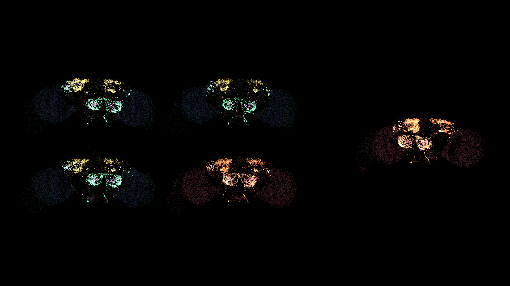
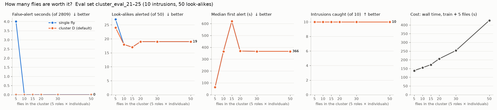

# FlySOC

A biologically inspired detection engine for security telemetry, built on the real wiring of a
fruit fly brain. The FlyWire 783 connectome of *Drosophila melanogaster* (138,639 neurons, 15.1M
connections) runs as a spiking network on the GPU. Log events are turned into "smells", and the
fly's mushroom body learns which smells are safe, the same way a real fly learns odours.

The goal is to help a human SOC (security operations centre) analyst, not to replace one. FlySOC
flags anomalous activity across network, login, process and DNS telemetry, links alarms that
concern the same host or user into incidents, and runs locally. Attack stages are modelled on
MITRE ATT&CK techniques. All results so far are on synthetic telemetry generated by the scripts
in `tools/` (fictional hosts and users). Real data is the next big step.



## How it works, in short

1. **Encoding.** Each event (a connection, login, process start or DNS query) becomes an odour: a
   combination of the fly's 53 olfactory glomeruli, plus a summary of recent history (how many
   ports this source touched, how many users failed to log in from it, and so on).
2. **Circuit.** A 9,262-neuron slice of the real connectome: receptors, antennal lobe, Kenyon
   cells, lateral horn and mushroom body output neurons. It uses the leaky integrate-and-fire model
   of Shiu et al. 2024.
3. **Learning.** Labelled training traffic stands in for dopamine and weakens the Kenyon cell →
   output synapses of smells known to be safe. Afterwards, whatever still makes the output neurons
   fire is "not known to be safe".
4. **Cluster.** Four specialist flies (network, identity, endpoint, DNS) and one generalist run
   side by side in one simulation. A coordinator raises an incident when flies agree about the
   same entity.
5. **Red vs blue.** An evolutionary attacker varies the intrusion's pacing, within limits that keep
   every stage a real attack, to find blind spots and harden the detector.

## Status

- Phase 0, done: watch a whole fly brain think.
- Phase 1, done: logs are encoded into smells, and a pruned smell circuit of the fly responds to them.
- Phase 2, done on synthetic data: the mushroom body learns from labels. On held-out data, trained
  flies catch every port scan from second 0 and ignore legitimate bursts.
- Phase 3, met on precision, not on speed: four specialist flies, a single fly that smells
  everything, and a coordinator that links alarms by host or user. On 10 held-out intrusions, the
  default rule (the team confirms the single fly) catches 10/10 at a median +94 s, with no
  false-alarm seconds, like the single fly alone (see Phase 3).
- Phase 4, started: red vs blue evolution (`tools/red.py`).

Every problem we hit, its cause and its fix is logged in [docs/ISSUES.md](docs/ISSUES.md), with the
open issues first.

## Requirements

- A Vulkan-capable GPU (developed on an RTX 4090; one process uses about 210 MiB of GPU memory).
- Rust (edition 2024), Python 3 and [uv](https://docs.astral.sh/uv/) for the data conversion.
- About 500 MB of disk for the connectome download, the converted brain and generated telemetry.
  None of it is in the repository: `data/` is rebuilt by the commands below.

## Run

```sh
# one-time data download (public) and conversion -> data/fly.bin (64 MB) + data/fly.json
mkdir -p data/raw && cd data/raw
curl -LO https://github.com/philshiu/Drosophila_brain_model/raw/main/Connectivity_783.parquet
curl -LO https://github.com/philshiu/Drosophila_brain_model/raw/main/Completeness_783.csv
curl -L -o annotations.tsv https://github.com/flyconnectome/flywire_annotations/raw/main/supplemental_files/Supplemental_file1_neuron_annotations.tsv
cd ../.. && uv run tools/convert.py
python3 tools/gen_traffic.py    # port scan telemetry -> data/telemetry/
python3 tools/gen_intrusion.py  # multi-stage intrusion telemetry -> data/telemetry/cluster_*
                                #   (train, test, holdout, and 5+5 files for choosing / reporting)

cargo run --release            # whole-brain viewer
cargo run --release -- bench   # 1 s of whole-brain fly time, headless
cargo run --release -- detect --train data/telemetry/train.jsonl data/telemetry/baseline.jsonl data/telemetry/holdout.jsonl
cargo run --release -- cluster data/telemetry/cluster_train.jsonl data/telemetry/cluster_holdout.jsonl
cargo run --release -- watch data/telemetry/cluster_train.jsonl data/telemetry/cluster_holdout.jsonl
cargo test --release
```

`detect [--train <labelled>] <baseline> <events>` takes JSON-lines telemetry. It optionally learns
from labelled telemetry first, calibrates on benign traffic, then prints one JSON alert per anomalous
second to stdout and a per-incident scorecard against the `label` field to stderr. Labels starting
with `benign` count as safe, any other label as an attack. Set `FLYSOC_TRACE=1` for per-second
spike counts of projection neurons (ALPN), Kenyon cells, mushroom body output neurons (MBON) and
lateral horn local neurons (LHLN). Training takes a few seconds and is not saved yet.

`cluster <labelled> <events>` trains the four specialists and the single fly, then prints one JSON
incident per alerted second (with confidence and the flies that agree) to stdout, and a scorecard
for every fly and the cluster to stderr. The trained cluster is cached in `data/cache/`, keyed on the
training file and the FlySOC binary: the first run trains (about 36 s), later runs load it at once
and only play the events (about 17 s for 2400 s of telemetry).

`watch <labelled> <events>` trains the cluster the same way (or loads it from the cache), then plays
`events` live in 3D. The four specialists are a 2x2 grid on the left (network and identity on top,
endpoint and DNS below) and the single fly is on the right. Each fly is drawn as its whole brain, dim, with its simulated circuit lit
inside it. Circuit neurons are coloured by layer: receptors green, antennal lobe purple, Kenyon
cells orange, lateral horn teal, output neurons pink. They flash when they spike, and a fly turns
red while it raises an alarm. The window title and the terminal (one line whenever something changes, since some
compositors, Hyprland included, show no titles) show the telemetry second, what is really
happening, which flies are red, and any cluster incident. Keys: R restarts the playback, +/- change
speed (default 1 s of telemetry per frame), Space pauses, Esc quits. It loops at the end until you
close it.

`snapshot <labelled> <events> <second> <out.ppm>` renders the `watch` view at a given telemetry
second offscreen, without a window, as a 1920x1080 PPM image. This is how `docs/watch.png` (top of
this page) was made: second 1010 of the holdout, the first intrusion's DNS exfiltration, with the
DNS fly and the single fly red.

`FLYSOC_TRACE=<file>` writes every fly's per-second MBON spikes as TSV.

Viewer: drag to orbit, scroll to zoom, Space to pause, R to silence all neurons, +/- to change speed.
Keys 1-9 and 0 toggle 150 Hz Poisson input into every 10th neuron of a super class, in this order:
optic, central, sensory (on at start), visual_projection, ascending, descending, sensory_ascending,
visual_centrifugal, motor, endocrine.

## Model

Leaky integrate-and-fire with the parameters from Shiu et al. 2024, *A Drosophila computational brain
model reveals sensorimotor processing* (Nature): dt 0.1 ms, 1.8 ms delay, 2.2 ms refractory, 0.275 mV
per synapse, weights are signed synapse counts (sign from the predicted neurotransmitter).

Event driven, two dispatches per step (`src/sim.wgsl`): neurons integrate and append spikes to a
list, then an indirect dispatch pushes each spike's outgoing weights into a delay ring with integer
atomics. One extra workgroup of that dispatch advances the clock and resets the next step's spike
counter (two counters alternate). Only spiking neurons touch synapses: the whole brain runs at about
9.6x real time on an RTX 4090. A pull version that read every synapse each step ran at 0.06x.
Telemetry input is uploaded as a list of the neurons to fire per 1 ms bin, sent in batches of 5
bins, not as a full input array per bin.

**Whole brain (viewer, bench):** needs spike-frequency adaptation (+10 mV per spike, 1 s decay),
which Shiu et al. do not have. Without it, about 2 s of sparse input locks about 9,000 central brain
neurons into firing that never stops. Even with it, steady input makes the brain "ignite" every
minute or so: 60% of Kenyon cells fire at once, whatever the input was.

**Network specialist circuit (detect):** the design notes' pruned specialist. It is 9,262 neurons
in four layers: receptors (ORN), antennal lobe (ALPN, ALLN, ALIN, ALON), Kenyon cells and lateral
horn (LHLN, LHCENT), and output neurons (MBON, plus the APL inhibitory neuron). Two choices make it
stable without adaptation, so it is the Shiu model unchanged:

- Dopamine neurons are not simulated. In flies they modulate learning rather than excite, so they
  become the learning signal.
- All inhibitory connections are kept, but excitatory ones only where they go forward a layer.
  The cut ones are mostly axon-to-axon: Kenyon cell → Kenyon cell alone is 40% of the circuit, and
  synapses onto receptor axon terminals are another source. A point neuron model turns them into
  loops that fire forever. Standard mushroom body models are feedforward with APL inhibition too.

The result is sparse Kenyon cell coding (about 1% active, flies show 5-10%), and scans and bursts
give different Kenyon cell patterns (cosine similarity 0.13, up from 0.93 in the whole brain).

## Encoding

Each event is an "odour" made of components: one per field, plus one summary of recent history.
Each field component hashes to 2 of 40 olfactory glomeruli, so an event activates a combination of
glomeruli, as real odours do. The other 13 of the 53 glomeruli are reserved for history, like the
dedicated glomeruli real flies have for innately important smells. A history value in bucket b lights
reserved glomeruli b to b+3, so similar magnitudes overlap and very different ones never do. The event's receptor neurons fire a
puff: 5 spikes 4 ms apart, like a real odour response. One second of telemetry plays as 50 ms of fly
time.

| kind | field components | history component (distinct values in the last 60 s, bucketed by powers of two) |
|---|---|---|
| conn | source, destination port | ports this source touched |
| auth | user, source, destination, result | users that failed to log in from this source |
| proc | host, process, parent | processes started on this host |
| dns | host, base domain, length of the first label / 8 | names this host looked up under this base domain |

History components exist because attacks like scans and sprays are patterns across events: each
failed login of a password spray looks like an ordinary typo. They get 4 glomeruli instead of 2,
otherwise the event's own fields drown them out (spray and typo then still looked alike). They get
glomeruli of their own because, when they shared the hash with fields, results depended on which
fields they happened to collide with: other hash seeds had 8 to 229 false-alarm seconds where ours
had 0 (ISSUES E9).

Four things were needed to make this work:
- A single synchronous receptor spike barely reaches the Kenyon cells: about 2 Kenyon spikes per
  event. A puff gives about 170.
- Hashing a whole event key to one smell made "the scanner on port 123" and "the scanner on port
  456" unrelated, so nothing could ever become familiar.
- Hashing fields into random sensory neurons failed outright: two thirds of those are
  photoreceptors, and the input never got past the first layer.
- Without history components, the identity fly could not see a password spray and the network fly
  could not see a slow scan at all.

## Learning (Phase 2)

Learning happens where flies learn: the 62,261 Kenyon cell → MBON synapses, which are kept apart
from the fixed connections, with float weights. They start at 16x their synapse count, because the
counts alone leave MBONs silent at 1% Kenyon activity. The delay ring counts 1/16 synapses so small
weight changes register.

The rule is the fly's three-factor rule (Hige et al. 2015): dopamine arriving while a Kenyon cell
is active depresses that cell's output synapses. The label stands in for dopamine and is applied once
per one-second window: in safe windows, every spike of a Kenyon cell cuts its output weights by 10%.
In attack windows, they recover 5% of the way back per spike. Every weight also drifts 0.2% of the
way back each window, so "familiar" means "seen often", not "seen once". Without that drift, busy
traffic eventually depresses every Kenyon cell and new smells find nothing left to drive the MBONs.
After training, what still drives the MBONs is "not known to be safe". This is not pair-based STDP: at this synapse, flies depend on
coincidence with dopamine, not on spike order.

The readout is MBON spikes per second. An alert fires above max(benign mean + 4σ, 20 spikes).

## Results: port scans (Phase 2)

Trained on `train.jsonl` (seed 5). Settings were tuned on `test.jsonl` (seed 2) and are reported here
on `holdout.jsonl` (seed 7, other incident times), which was never used for tuning. Alerts within
2 s after an incident count as part of it.

| Holdout, 600 s | Untrained | Trained |
|---|---|---|
| 4 port scans, 100 conn/s to 1000 ports | 4/4 caught, 36/40 windows, 1 s in | 4/4 caught, 40/40 windows, 0 s in |
| 4 backup bursts, 100 conn/s to one port | 0/4 (0/40 windows) | 0/4 (0/40 windows) |
| benign-only windows | 0/502 false alerts | 2/502 false alerts |

With the field-wise encoding, the backup host and SMB port are already familiar parts of the odour,
so even the untrained fly no longer alerts on bursts. Learning makes scans fire sooner and in every
window.

## Phase 3: cluster

`tools/gen_intrusion.py` writes 2400 s of four-domain telemetry (network, logins, processes, DNS;
about 40 events/s) with two intrusions. Each intrusion is four quiet stages, minutes apart, from one
compromised workstation:

1. A slow scan (0.33 conn/s).
2. A password spray (15 users, one failure each).
3. Lateral movement with psexec to two servers the account never used.
4. DNS exfiltration through long random subdomains.

Every stage has a benign look-alike: the authorised vulnerability scanner, a user mistyping their
password, an admin doing psexec maintenance, someone browsing 60 new sites, and the backup burst.

Four specialist flies each smell one domain, and a fifth fly smells everything. All five are the
same circuit and run together in one simulation, as disjoint copies (about 3 MB of GPU memory each).
The simulation is limited by dispatches per 0.1 ms step, not by neuron count, so five flies take
about as long as one.

How a fly fires:
- Its evidence is its MBON spikes per second, averaged over about 20 s, because stages last minutes
  and single seconds are noisy.
- After training, it replays its training data without learning. From then on it fires only above
  the 99.9th percentile of the evidence it showed on safe training seconds, look-alikes included.
  (The maximum, used at first, hung on a single outlier second; ISSUES L7.)

The coordinator links alarms by entity. Each fly names its suspects: the entities behind its most
extreme history count in the last 20 s (the source fanning out over ports, the source failing many
users, the host with many new processes, the host sending many names to one domain). Stages of one
intrusion share entities: the scan and the spray come from the same workstation against the same
server, and exfiltration leaves from a server reached by lateral movement. Unrelated look-alikes
rarely share one. `cluster` scores four rules for raising an incident. Each needs 2 flies that fired
within 300 s to agree about the same entity, except where noted:

- **A team**: 2 of the 4 specialists agree.
- **B team or single**: the single fly fires alone, or A.
- **C all vote**: 2 of all 5 flies agree.
- **D confirmed** (the default, used by `watch` and the JSON output): the single fly fires and at
  least one specialist agrees with it.

**Evaluation.** One file of 2 intrusions and 10 look-alikes turned out far too small: the rule that
won on `cluster_test` lost on `cluster_holdout`. So there are two sets of 5 files with random timings,
each with 10 intrusions and 50 look-alikes. `cluster_eval_*` (seeds 21-25) was used to choose the
default rule. `cluster_final_*` (seeds 31-35) was never used for any choice, and these are its
numbers. Training is always `cluster_train.jsonl` (seed 11). Alerts within 60 s after an incident
count as part of it, because the evidence average remembers that long.

Look-alikes are benign activity, so alerting on one is a false positive: lower is better. Arrows in the header show which direction is better.

| final set | intrusions caught ↑ | median first alert ↓ | look-alikes alerted ↓ | false alert seconds ↓ |
|---|---|---|---|---|
| network fly | 10/10 | **+40 s** | 19/50 | 279/2549 |
| identity fly | 10/10 | +254 s | 20/50 | 17/2549 |
| endpoint fly | 8/10 | +202 s | 15/50 | 33/2549 |
| DNS fly | 10/10 | +234 s | 23/50 | 21/2549 |
| single fly | 10/10 | +94 s | 25/50 | **0/2549** |
| A team | 10/10 | +253 s | **19/50** | 18/2549 |
| B team or single | 10/10 | +90 s | 33/50 | 18/2549 |
| C all vote | 10/10 | +90 s | 35/50 | 18/2549 |
| **D confirmed** | **10/10** | +94 s | 22/50 | **0/2549** |

(Before E9 and the 99.9% threshold, the same set gave D +137 s, 20/50, 16 false seconds, and the
single fly +102 s, 23/50, 46. Both changes were chosen on the eval set.)

**Verdict.** Every rule catches all 10 intrusions. D and the single fly alert at a median +94 s and
never alarm on plain traffic. D now matches the single fly rather than beating it: the team's
confirmation costs no time any more, and saves 3 look-alike alerts (22 vs 25, within noise).
B and C are no faster and alarm on 18 seconds of plain traffic. The network fly alone sees every scan
within a minute, but alarms for 279 seconds. With 50 look-alikes, differences of a few alerts are
within noise.

What each specialist can and cannot see:
- **DNS** catches every exfiltration, but late: exfiltration is the last stage.
- **Network** sees every slow scan and is the fastest, but is also the noisiest on plain traffic
  (279 false seconds).
- **Identity** catches every password spray. Spray and typo differ only in the history component.
- **Endpoint** catches lateral movement, but cannot tell an attacker's psexec from an admin's.

What it took (all in [docs/ISSUES.md](docs/ISSUES.md)): history components so the specialists can see
their stage (E7, E8), entity correlation against unrelated look-alikes (M8), bigger evaluation
sets (M9), and history glomeruli of their own (E9).

**More flies.** `FLYSOC_REPLICAS=R` gives every role R individual flies: the same circuit, but each
feature lands on different glomeruli (`Encoder::individual`). Their output spikes are summed into one
voter per role, so the coordinator still sees five roles. Extra flies are cheap, because the GPU is
bound by dispatches, not neurons. 50 flies play 2417 s in 58 s in `watch` (one row per role, one
column per individual). Eval set (cluster_eval_21-25), rule D:

| flies | median first alert ↓ | look-alikes alerted ↓ | false alert seconds ↓ | train + 5 files |
|---|---|---|---|---|
| **5 (default)** | **+64 s** | 24/50 | 0/2809 | 138 s |
| 10 | +366 s | **18/50** | 0/2809 | 155 s |
| 15 | +620 s | 17/50 | 0/2809 | 172 s |
| 20 | +368 s | 19/50 | 0/2809 | 206 s |
| 30 | +366 s | 19/50 | 0/2809 | 253 s |
| 50 | +366 s | 19/50 | 0/2809 | 426 s |



More flies are not worth it. Every count catches 10/10 without false alarms (since E9; before, 15+
flies had over 100 false-alarm seconds). Extra individuals alert on about 5 fewer look-alikes, but
rule D then waits five times as long, because most individuals are slow on their own (E9 table)
and summing averages toward them. The default stays at 5 flies. Times are from a run with nothing
else on the GPU (the latest sweep shared it with a game; its times are in
`data/runs/flies_time_busy_gpu.txt`). Raw scorecards are in `data/runs/flies*_eval_*.txt`;
`tools/flies_roi.py` redraws the graph.

Open directions for Phase 3: per-entity learning from look-alike labels, a coordinator that learns
how much to trust each fly, and above all real data (O4) before drawing conclusions from one
synthetic scenario.

## Phase 4: red vs blue (started)

`tools/red.py` evolves the Phase 3 intrusion against the trained cluster. Red's genome is the pace
and size of each stage: ports scanned and over how long, accounts sprayed, servers reached, gaps
between stages, and how the 6000 hex chars of stolen data are split into DNS labels and spread out.
Every stage must still do its real job (ATT&CK T1046, T1110.003, T1021.002 + T1569.002, T1048): at
least 10 ports, at least 5 accounts, the whole payload. Red's score is its progress through the kill
chain before rule D raises an incident: per stage, the share of its events before the first
incident, averaged (1.0 = never caught). `python3 tools/red.py evolve <train> <out>` runs it, and
`harden` retrains blue on red's best and replays both against them.

First results, on backgrounds neither side had seen:

| intrusion | red progress (mean of 5 backgrounds) |
|---|---|
| unchanged Phase 3 intrusion | 0.66 |
| red's 3 best after 6 generations | 0.43, 0.68, 0.68 |
| only exfiltration slowed to 1000 s | 0.65 |
| only the spray slowed to 490 s | 0.42 |
| only the scan slowed to 900 s | 0.64 |

Red has not yet found a real evasion. Its "undetected" winners were lucky backgrounds: when blue
fires depends more on the surrounding traffic than on the attack's pace (O10). (This table predates
the 99.9% threshold of L7.) Blue, retrained on red's best, got worse: 7 of 12 replays caught
instead of 10, with either threshold. Why is open issue O9.

## Memory

| | Whole brain | Circuit |
|---|---|---|
| GPU, brain data | ~78 MB: 60 MB connections (each packed into 32 bits: 19-bit target, 13-bit signed weight; S16), 10.5 MB delay ring, ~7 MB state | ~3 MB per fly (cluster: 5 copies) |
| GPU, whole process | 207 MiB | 207 MiB |
| Host, private | 144 MiB | ~200 MiB (the full connectome is read, then pruned) |

The whole-process GPU number is almost all the NVIDIA Vulkan context, paid once per process. On
the host, connections are handed to the GPU and dropped, and only the Vulkan backend is loaded:
enabling GL as well loads the OpenGL and Mesa drivers too.

## Repository layout

| Path | What |
|---|---|
| `src/sim.rs`, `src/sim.wgsl` | GPU spiking simulation (event-driven LIF, delay ring, plastic synapses) |
| `src/detect.rs` | Event encoding, the specialist circuit, learning and the single-fly detector |
| `src/cluster.rs` | Specialists, coordinator, incident rules, training cache, `watch` driver |
| `src/view.rs`, `src/view.wgsl` | 3D viewer and offscreen snapshots |
| `tools/convert.py` | FlyWire export → `data/fly.bin` |
| `tools/gen_traffic.py`, `tools/gen_intrusion.py` | Synthetic telemetry with labelled attacks and benign look-alikes |
| `tools/red.py` | Phase 4 red team: evolves the intrusion, retrains blue |
| `tools/scorecards.py`, `tools/flies_roi.py` | Scorecard aggregation and the fly-count graph |
| `docs/ISSUES.md` | Every problem, its cause and fix |

## Credits

- Connectome: FlyWire 783 (Dorkenwald et al. 2024, *Nature*; Schlegel et al. 2024, *Nature*),
  annotations from [flywire_annotations](https://github.com/flyconnectome/flywire_annotations).
- Neuron model and connectivity export: Shiu et al. 2024, *A Drosophila computational brain model
  reveals sensorimotor processing*, *Nature*,
  [Drosophila_brain_model](https://github.com/philshiu/Drosophila_brain_model).
- Learning rule: Hige et al. 2015, *Heterosynaptic plasticity underlies aversive olfactory
  learning in Drosophila*, *Neuron*.

Check the FlyWire data's own terms before redistributing it or anything derived from it.
