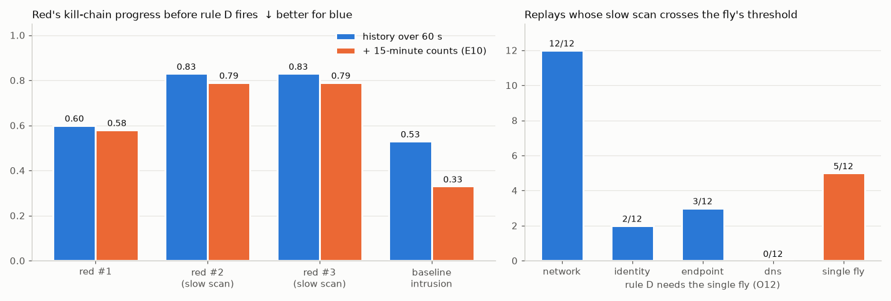
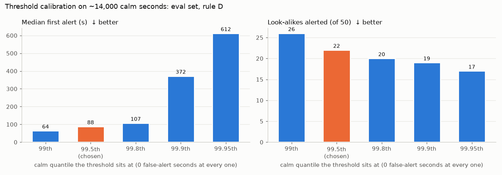

# FlySOC

A biologically inspired detection engine for security telemetry, built on the real wiring of a
fruit fly brain. The FlyWire 783 connectome of *Drosophila melanogaster* (138,639 neurons, 15.1M
connections) runs as a spiking network on the GPU. Log events are turned into "smells", and the
fly's mushroom body learns which smells are safe, the same way a real fly learns odours.

The goal is to help a human SOC (security operations centre) analyst, not to replace one. FlySOC
flags anomalous activity across network, login, process and DNS telemetry, links alarms that
concern the same host or user into incidents, and runs locally. Attack stages are modelled on
MITRE ATT&CK techniques. Most results are on synthetic telemetry generated by the scripts in
`tools/` (fictional hosts and users). First results on real enterprise telemetry, the public LANL
data set, are in [Real data](#real-data-lanl).


## How it works, in short

1. **Encoding.** Each event (a connection, login, process start or DNS query) becomes an odour: a
   combination of the fly's 53 olfactory glomeruli, plus a summary of recent history (how many
   ports this source touched, how many users failed to log in from it, and so on).
2. **Circuit.** A 9,262-neuron slice of the real connectome: receptors, antennal lobe, Kenyon
   cells, lateral horn and mushroom body output neurons. It uses the leaky integrate-and-fire model
   of Shiu et al. 2024.
3. **Learning.** Labelled training traffic stands in for dopamine and weakens the Kenyon cell →
   output synapses of smells known to be safe. Afterwards, whatever still makes the output neurons
   fire is "not known to be safe".
4. **Cluster.** Four specialist flies (network, identity, endpoint, DNS) and one generalist run
   side by side in one simulation. A coordinator raises an incident when the generalist and a
   specialist agree about the same entity, and a lower-tier lead when a specialist is far above
   its threshold and another fly agrees.
5. **Red vs blue.** Red is an evolutionary attacker (`tools/red.py`). It varies the intrusion's
   pacing and size, within limits that keep every stage a real ATT&CK technique, and plays each
   candidate against the real cluster on fresh background traffic. What it finds becomes blue's
   next fix: so far a 15-minute memory (E10) and a second alert tier (O12).

## Status

- Phase 0, done: watch a whole fly brain think.
- Phase 1, done: logs are encoded into smells, and a pruned smell circuit of the fly responds to them.
- Phase 2, done on synthetic data: the mushroom body learns from labels. On held-out data, trained
  flies catch every port scan within 1 s and ignore legitimate bursts.
- Phase 3, met on precision, not on speed: four specialist flies, a single fly that smells
  everything, and a coordinator that links alarms by host or user. On 10 held-out intrusions, the
  default rule (the team confirms the single fly) catches 10/10 at a median +89 s: 8 during the
  scan, within 2 minutes, 2 only at exfiltration, about 10 minutes in. Scored as an analyst's
  queue, 84% of its 45 alerts are about an intrusion; the rest are the authorised scanner (1) and
  alerts about nothing labelled (6) (see [Phase 3](#phase-3-cluster)).
- Phase 4, in progress: red vs blue evolution (`tools/red.py`). Red found a real evasion, a
  low-and-slow scan. Blue answered twice: 15-minute history counts (E10), and leads, a second alert
  tier for a specialist that is sure of itself (O12). With leads, all 10 held-out intrusions raise
  an alert within 2 minutes. Red then evolved against leads: slowing every stage at once, spray
  included, still reaches 0.84 of the kill chain on unseen backgrounds (O13; measured before Phase 9): blue's next round.
- Phase 5, in progress: Lean 4 proofs, checked with no `sorry`, of the encoding, the learning rule
  and the coordinator: weights stay in $(0, w^0]$ over any training run, and no single fly can
  raise an incident or a lead ([Lean 4](#lean-4-what-is-proved-phase-5)). About every trained
  fly: training can only quiet an odour through Kenyon cells that harmless traffic also lit, so an
  odour made of cells it never lit drives the trained fly exactly as hard as the untrained one.
  Still open: the spiking network between those Kenyon cells and the alarm.

- Real data: the flies run on the LANL enterprise data (17,684 computers), a 4-hour slice in about
  2 minutes. Since Phase 9's first step the identity fly smells how many accounts a source fails
  with, not their names, and since Phase 11 a fly without fan-out behind its suspects does not
  vote: on the final slices (days 12-14) the flies raise 82 false alarm episodes in 12 hours
  instead of 184, and 4 of the identity fly's 10 are about the red team (before: 6 of 41). A plain
  count of the same input still finds more (O16).
- Phase 8, done: baselines on the same final data, scored the same way. On synthetic data the flies
  win: the single fly names all 10 intrusions with no false episode (+78 s), the network fly 9 of
  10 at +36 s; the best baseline needs +240 s. On LANL a plain count of the identity fly's own input
  (failed users per source) was far more precise than the fly (O16); Phase 9's first step brought
  the fly level with it. See [Baselines](#baselines-phase-8).
- Phase 9, in progress: a probe showed the identity fly reacted to new names, not to how many
  accounts a source fails with; on a big network names are new everywhere. The identity fly now
  smells only the counts ([Phase 9](#phase-9-how-many-not-who)). Still to do: integrating over time.
- Phase 10, started: sleep is built (`MushroomBody::sleep`, opt-in `FLYSOC_SLEEP=1`): at night each
  Kenyon cell's output weight is restored to a floor set by how rarely it fired in harmless seconds
  ([Sleep](#sleep-phase-10-mushroombodysleep-opt-in-flysoc_sleep1)); 13 Rust tests, 14 Lean
  theorems. Measured on the eval sets it changes nothing that matters (LANL 11 attack episodes
  against 10, synthetic identical), so it stays off: the identity fly's blind spot is in the
  encoding, not in over-learned weights (O16, O17). Analyst marks and dreams come next.
- Phase 11, done for the alert text: every JSON alert says why each firing fly fired, with the
  count behind it, and which ATT&CK technique that fits; checked by hand on synthetic and LANL
  alerts ([Phase 11](#phase-11-explaining-alerts)). The explanations exposed that every false DNS
  alarm on LANL had no fan-out behind it; a fly now votes only with fan-out (O18): rule D's queue
  on the synthetic final set rose from 75% to 84% precision, detection unchanged. The sentences are
  FlySOC's bookkeeping, not the fly's words; counterfactual replays ask the fly whether they name
  the cause (identity fly: 25 of 27 confirmed on synthetic final). The neural path (which neurons
  carried an alarm) is left for Phase 6's view.
- Phase 6, not started beyond the viewer: the full 3D view.
- Phase 7, not started: packaging.

### Roadmap: phases added after Phase 7

Order of work: 8, 9, 10, 11, then the rest of Phases 5-7, then 12. Phases 13 and 14 are maybes.

| phase | what | done when |
|---|---|---|
| 8. Baselines | Simple per-entity statistics (counts, rarity scores) and a standard anomaly model (isolation forest) on the same LANL slices and synthetic files, scored the same way (`tools/lanl_score.py`, `tools/attribution.py`). | A table next to every flies result: alarms, precision, first naming of the attacker, for flies and baselines on the same final slices. Whatever the outcome, it is reported. |
| 9. The brain handles time | The evening miss (O15) is a time problem: one odd logon a minute. Replace the hand-written 20 s evidence average with circuits from the connectome that integrate over time (e.g. a recurrent integrator downstream of the MBONs, or the mushroom body's long-term memory compartments), and document the departure it removes. | The identity fly names `C17693` on LANL eval_2 without losing eval_1 or raising false alarms; the integrator's neurons are named from FlyWire annotations; the synthetic results hold. |
| 10. The analyst teaches the fly, and the fly sleeps | An analyst marks an alert false positive or real; that becomes a dopamine signal and the fly learns from it on the spot (the same Hige rule, applied online). A sleep phase between days: replay the day's odours and pull Kenyon cell output weights back toward rest in proportion to how rarely each pattern was met (synaptic homeostasis; fruit fly synapses shrink in sleep), so one harmless sighting does not blind the fly to a pattern for good; and "dreams": rehearse attack variants from `tools/red.py`. Initial inspiration: Google's SLEEP framework for LLMs; what we do differently and why is in [Phase 10 design](#phase-10-design-a-fly-that-sleeps). | Measured on LANL: alarm rate against the number of analyst marks; a mark on one benign source does not blind the fly to an attack from another; over several simulated days with sleep, harmless patterns that recur stop alarming while rare patterns and attacks still alarm, against the same days without sleep. |
| 11. Explain every alert | Trace each alarm back: readout neurons, Kenyon cells, glomeruli, event fields, then one sentence ("C17693 used 18 accounts in 15 minutes; this fly has never smelled that"). Phase 6's view lights up that path. | Every JSON alert carries its explanation; checked by hand on a sample of LANL and synthetic alerts. |
| 12. Live mode | Read logs as they happen: Zeek for network flows; Sysmon or Windows event logs for logons and processes; from a homelab or a single machine. Uses Phase 10 to adapt. | FlySOC runs for a week on a live network, with alarms and analyst marks logged. |
| 13. Human vs fly (maybe) | Red vs blue as a game: a person plays the attacker against the trained flies on the synthetic network, or the analyst against red's evolved attacks. Reuses `tools/red.py`, the viewer and the coordinator. | Playable from one command, with a score. |
| 14. Write it up (maybe) | A paper or long-form writeup: method, LANL results against Phase 8's baselines, the Lean proofs, and the negative results from ISSUES. | A draft in `docs/`. |

Every problem we hit, its cause and its fix is logged in [docs/ISSUES.md](docs/ISSUES.md), with the
open issues first.

## Requirements

- A Vulkan-capable GPU (developed on an RTX 4090; one process uses about 210 MiB of GPU memory).
- Rust (edition 2024), Python 3 and [uv](https://docs.astral.sh/uv/) for the data conversion.
- Optional, for the proofs: Lean 4 via [elan](https://github.com/leanprover/elan) (about 3 GB in
  `~/.elan`, plus about 7 GB of Mathlib cache in `proofs/.lake`).
- About 500 MB of disk for the connectome download, the converted brain and generated telemetry.
  None of it is in the repository: `data/` is rebuilt by the commands below.

## Run

```sh
# one-time data download (public) and conversion -> data/fly.bin (64 MB) + data/fly.json
mkdir -p data/raw && cd data/raw
curl -LO https://github.com/philshiu/Drosophila_brain_model/raw/main/Connectivity_783.parquet
curl -LO https://github.com/philshiu/Drosophila_brain_model/raw/main/Completeness_783.csv
curl -L -o annotations.tsv https://github.com/flyconnectome/flywire_annotations/raw/main/supplemental_files/Supplemental_file1_neuron_annotations.tsv
cd ../.. && uv run tools/convert.py
python3 tools/gen_traffic.py    # port scan telemetry -> data/telemetry/
python3 tools/gen_intrusion.py  # multi-stage intrusion telemetry -> data/telemetry/cluster_*
                                #   (cluster_calib.jsonl: benign traffic for the cluster's thresholds)
                                #   (train, test, holdout, and 5+5 files for choosing / reporting)

cargo run --release            # whole-brain viewer
cargo run --release -- bench   # 1 s of whole-brain fly time, headless
cargo run --release -- detect --train data/telemetry/train.jsonl data/telemetry/baseline.jsonl data/telemetry/holdout.jsonl
cargo run --release -- cluster data/telemetry/cluster_train.jsonl data/telemetry/cluster_holdout.jsonl
cargo run --release -- watch data/telemetry/cluster_train.jsonl data/telemetry/cluster_holdout.jsonl
cargo test --release            # 34 tests, below
```

`cargo test` checks the encoding (stable odours, history counts, the overlapping count code pinned
glomerulus for glomerulus, shards split every event to exactly one fly, a history-only fly smells
counts and never names), learning (safe windows depress,
attacks restore) and sleep (max of the day and the floor, never lowering a weight over random
days, keeping what attacks taught, the floor falling with frequency, attack windows and spike
counts not counted as harmless sightings, flies counting independently), the sharded readout (one threshold for busy
and quiet shards, bursts standing out), explanations (every count's sentence and technique, no
claim without fan-out, reasons carried through, the four verdicts of a counterfactual replay and
which events involve a suspect), the fan-out vote, and one GPU spike test (skipped without `data/fly.bin`).
The sleep and readout tests were checked against planted bugs (overwriting instead of restoring,
min for max, wrong scaling, counting attack seconds or spikes, no reset, dividing by a constant):
each fails at least one test.

`detect [--train <labelled>] <baseline> <events>` takes JSON-lines telemetry. It optionally learns
from labelled telemetry first, calibrates on benign traffic, then prints one JSON alert per anomalous
second to stdout and a per-incident scorecard against the `label` field to stderr. Labels starting
with `benign` count as safe, any other label as an attack. Set `FLYSOC_TRACE=1` for per-second
spike counts of projection neurons (ALPN), Kenyon cells, mushroom body output neurons (MBON) and
lateral horn local neurons (LHLN). Training takes a few seconds and is not saved yet.

`cluster <labelled> <events>` trains the four specialists and the single fly, then prints one JSON
alert per alerted second to stdout, with its tier (`"kind":"incident"` by rule D, or `"lead"` by
rule E where D is silent), its case (`"case"`, see below), confidence, the flies that agree and
everything they name with the entity (`"named"`), why each firing fly fired (`"why"`) and the ATT&CK
techniques that is consistent with (`"attack"`, see [Phase 11](#phase-11-explaining-alerts)), and a scorecard
for every fly and the cluster to stderr. The trained cluster is cached in `data/cache/`, keyed on the
training file, the calibration file and the FlySOC binary: the first run trains and calibrates
(about 2 minutes: 19 s training, 96 s calibration replays), later runs load it at once
and only play the events (about 17 s for 2400 s of telemetry).

`watch <labelled> <events>` trains the cluster the same way (or loads it from the cache), then plays
`events` live in 3D. The four specialists are a 2x2 grid on the left (network and identity on top,
endpoint and DNS below) and the single fly is on the right. Each fly is drawn as its whole brain, dim, with its simulated circuit lit
inside it. Circuit neurons are coloured by layer: receptors green, antennal lobe purple, Kenyon
cells orange, lateral horn teal, output neurons pink. They flash when they spike, and a fly turns
red while it raises an alarm. The window title and the terminal (one line whenever something changes, since some
compositors, Hyprland included, show no titles) show the telemetry second, what is really
happening, which flies are red, and any cluster incident. Keys: R restarts the playback, +/- change
speed (default 1 s of telemetry per frame), Space pauses, Esc quits. It loops at the end until you
close it.

`snapshot <labelled> <events> <second> <out.ppm>` renders the `watch` view at a given telemetry
second offscreen, without a window, as a 1920x1080 PPM image. This is how `docs/watch.png` (top of
this page) was made: second 1010 of the holdout, the first intrusion's DNS exfiltration, with the
DNS fly and the single fly red.

`FLYSOC_TRACE=<file>` writes every fly's per-second MBON and Kenyon cell spikes as TSV.
`FLYSOC_FLY_LOG=<file>` writes every second a fly is alarmed, with the suspects it names and why, as TSV.
`FLYSOC_SHARDS=1` (with `FLYSOC_REPLICAS=K`) splits each role's K individuals by source instead
of giving each all events, each measured against its own 30-minute background (O15, experimental).
`FLYSOC_HISTORY_ONLY=<roles>` sets which roles smell only history counts (default `identity`;
empty for none; Phase 9).
`FLYSOC_VERIFY=1` checks each new alert's suspect by a counterfactual replay ([Phase 11](#phase-11-explaining-alerts)).
`FLYSOC_CALIB=<file>` calibrates thresholds on another benign file (default
`data/telemetry/cluster_calib.jsonl`; LANL uses its own weekday slice).

Viewer: drag to orbit, scroll to zoom, Space to pause, R to silence all neurons, +/- to change speed.
Keys 1-9 and 0 toggle 150 Hz Poisson input into every 10th neuron of a super class, in this order:
optic, central, sensory (on at start), visual_projection, ascending, descending, sensory_ascending,
visual_centrifugal, motor, endocrine.

## Model

Leaky integrate-and-fire with the parameters from Shiu et al. 2024, *A Drosophila computational brain
model reveals sensorimotor processing* (Nature): dt 0.1 ms, 1.8 ms delay, 2.2 ms refractory, 0.275 mV
per synapse, weights are signed synapse counts (sign from the predicted neurotransmitter).

Event driven, two dispatches per step (`src/sim.wgsl`): neurons integrate and append spikes to a
list, then an indirect dispatch pushes each spike's outgoing weights into a delay ring with integer
atomics. One extra workgroup of that dispatch advances the clock and resets the next step's spike
counter (two counters alternate). Only spiking neurons touch synapses: the whole brain runs at about
9.6x real time on an RTX 4090. A pull version that read every synapse each step ran at 0.06x.
Telemetry input is uploaded as a list of the neurons to fire per 1 ms bin, sent in batches of 5
bins, not as a full input array per bin.

**Whole brain (viewer, bench):** needs spike-frequency adaptation (+10 mV per spike, 1 s decay),
which Shiu et al. do not have. Without it, about 2 s of sparse input locks about 9,000 central brain
neurons into firing that never stops. Even with it, steady input makes the brain "ignite" every
minute or so: 60% of Kenyon cells fire at once, whatever the input was.

**Network specialist circuit (detect):** the design notes' pruned specialist. It is 9,262 neurons
in four layers: receptors (ORN), antennal lobe (ALPN, ALLN, ALIN, ALON), Kenyon cells and lateral
horn (LHLN, LHCENT), and output neurons (MBON, plus the APL inhibitory neuron). Two choices make it
stable without adaptation, so it is the Shiu model unchanged:

- Dopamine neurons are not simulated. In flies they modulate learning rather than excite, so they
  become the learning signal.
- All inhibitory connections are kept, but excitatory ones only where they go forward a layer.
  The cut ones are mostly axon-to-axon: Kenyon cell → Kenyon cell alone is 40% of the circuit, and
  synapses onto receptor axon terminals are another source. A point neuron model turns them into
  loops that fire forever. Standard mushroom body models are feedforward with APL inhibition too.

The result is sparse Kenyon cell coding (about 1% active, flies show 5-10%), and scans and bursts
give different Kenyon cell patterns (cosine similarity 0.13, up from 0.93 in the whole brain).

## Encoding

Each event is an "odour" made of components: one per field, plus summaries of recent history.
Each field component hashes to 2 of the glomeruli left for fields, so an event activates a
combination of glomeruli, as real odours do. The rest of the 53 glomeruli are reserved for history,
like the dedicated glomeruli real flies have for innately important smells. A history value in
bucket b lights reserved glomeruli b to b+3 of its code, so similar magnitudes overlap and very
different ones never do. Fan-out counts (ports, failed users, DNS names) come twice: over the last
60 s and over the last 15 minutes, each with its own code of 10 glomeruli (33 left for fields).
Process counts only use the last minute, so the endpoint fly keeps one code of 13 (40 for fields).
The event's receptor neurons fire a puff: 5 spikes 4 ms apart, like a real odour response. One
second of telemetry plays as 50 ms of fly time.

| kind | field components | history components (distinct values in the last 60 s and 15 min, bucketed by powers of two) |
|---|---|---|
| conn | source, destination port | ports this source touched (60 s, 15 min) |
| auth | user, source, destination, result | users that failed to log in from this source (60 s, 15 min) |
| proc | host, process, parent | processes started on this host (60 s) |
| dns | host, base domain, length of the first label / 8 | names this host looked up under this base domain (60 s, 15 min) |

History components exist because attacks like scans and sprays are patterns across events: each
failed login of a password spray looks like an ordinary typo. They get 4 glomeruli instead of 2,
otherwise the event's own fields drown them out (spray and typo then still looked alike). They get
glomeruli of their own because, when they shared the hash with fields, results depended on which
fields they happened to collide with: other hash seeds had 8 to 229 false-alarm seconds where ours
had 0 (ISSUES E9). The 15-minute counts came from red vs blue: red's best intrusions scanned one
port every 24 s and spread exfiltration over half an hour, which looks like any workstation within
a minute (ISSUES E10).

Four things were needed to make this work:
- A single synchronous receptor spike barely reaches the Kenyon cells: about 2 Kenyon spikes per
  event. A puff gives about 170.
- Hashing a whole event key to one smell made "the scanner on port 123" and "the scanner on port
  456" unrelated, so nothing could ever become familiar.
- Hashing fields into random sensory neurons failed outright: two thirds of those are
  photoreceptors, and the input never got past the first layer.
- Without history components, the identity fly could not see a password spray and the network fly
  could not see a slow scan at all.

## Learning (Phase 2)

Learning happens where flies learn: the 62,261 Kenyon cell → MBON synapses, which are kept apart
from the fixed connections, with float weights. They start at 16x their synapse count, because the
counts alone leave MBONs silent at 1% Kenyon activity. The delay ring counts 1/16 synapses so small
weight changes register.

The rule is the fly's three-factor rule (Hige et al. 2015): dopamine arriving while a Kenyon cell
is active depresses that cell's output synapses. The label stands in for dopamine and is applied once
per one-second window: in safe windows, every spike of a Kenyon cell cuts its output weights by 10%.
In attack windows, they recover 5% of the way back per spike. Every weight also drifts 0.2% of the
way back each window, so "familiar" means "seen often", not "seen once". Without that drift, busy
traffic eventually depresses every Kenyon cell and new smells find nothing left to drive the MBONs.
After training, what still drives the MBONs is "not known to be safe". This is not pair-based STDP: at this synapse, flies depend on
coincidence with dopamine, not on spike order.

The readout is MBON spikes per second. An alert fires above max(benign mean + 4σ, 20 spikes).

## The mathematics

What the code computes, written down. Symbols match the constants in `src/`. Every equation here
is implemented exactly as written. Shiu et al.'s are marked; the rest are ours.

### Neurons (Shiu et al. 2024, `sim.wgsl`)

Leaky integrate-and-fire with conductance-like synaptic input. Voltage $v_i$ is measured from rest
($-52$ mV), so reset is $0$ and threshold $\vartheta = 7$ mV. Explicit Euler with
$\Delta t = 0.1$ ms:

```math
\begin{aligned}
v_i &\leftarrow v_i + \frac{\Delta t}{\tau_m}\bigl(g_i - v_i - a_i\bigr) \quad\text{unless } t - t_i^{\text{last}} < t_{\text{ref}}\\
g_i &\leftarrow g_i\Bigl(1 - \frac{\Delta t}{\tau_s}\Bigr) + w_{\text{syn}} \sum_{j} W_{ji}\,\bigl|\{\,k : t_j^{k} + d = t\,\}\bigr| + w_{\text{syn}}\,u_i(t)\\
a_i &\leftarrow a_i\Bigl(1 - \frac{\Delta t}{\tau_a}\Bigr), \qquad
v_i > \vartheta \;\Rightarrow\; v_i \leftarrow 0,\; a_i \leftarrow a_i + A,\; t_i^{\text{last}} \leftarrow t
\end{aligned}
```

with $\tau_m = 20$ ms, $\tau_s = 5$ ms, $w_{\text{syn}} = 0.275$ mV, $d = 1.8$ ms,
$t_{\text{ref}} = 2.2$ ms. $W_{ji}$ is the signed synapse count from $j$ to $i$ (sign from the
predicted transmitter); the delay ring adds it up in sixteenths of a synapse so small learned
weight changes register. $u_i(t)$ is input: 250 synapses' worth for a receptor neuron an event
fires (enough to fire it from rest). The adaptation $a_i$
($A = 10$ mV, $\tau_a = 1$ s) is ours and only used for the whole brain; the circuits run with
$A = 0$, which is Shiu et al.'s model unchanged.

Each connection is one 32-bit word: the target in the low 19 bits, the signed count in the high
13 (S16):

```math
s_{ji} = i \;\big|\; \bigl(W_{ji} \bmod 2^{13}\bigr) \ll 19, \qquad i < 2^{19} = 524{,}288,\quad |W_{ji}| \le 2405 < 2^{12}
```

### Odours (`detect.rs`)

A history count is the number of distinct values $x$ (ports, users, names, processes) recorded
under a key $k$ (a source, a host, a host and domain) in the last $T$ seconds:

```math
n_T(k, t) = \bigl|\{\, x : (\tau, x) \in H_k,\; t - T \le \tau \le t \,\}\bigr|,
\qquad b(n) = \begin{cases} 0 & n = 0 \\ \lfloor \log_2 n \rfloor + 1 & n \ge 1 \end{cases}
```

with $T \in \{60, 900\}$ s (processes: 60 only). Bucket $b$ lights four neighbouring glomeruli
of its code, which starts at offset $o$ and has $S$ glomeruli:

```math
G_{o,S}(b) = \bigl\{\, o + \min(b + k,\; S - 1) \;:\; k = 0, 1, 2, 3 \,\bigr\}
```

So magnitudes that are close share glomeruli and distant ones share none: away from the cap,
$|G(b) \cap G(b')| = \max(0,\, 4 - |b - b'|)$. Since $n_{60} \le n_{900}$ and $b$ is monotone,
an event's long bucket is never below its short one. A slow scan is the case
$b(n_{60}) \approx b_{\text{benign}} < b(n_{900})$.

### Learning (Hige et al. 2015, `MushroomBody::learn`)

Kenyon cell → MBON weights start at $w^0 = 16 \times$ synapse count. Once per telemetry second,
with $\alpha_j$ the spikes of synapse $j$'s Kenyon cell in that second:

```math
w_j \leftarrow w_j + \rho\,(w^0_j - w_j), \qquad
w_j \leftarrow \begin{cases}
w_j\,(1 - \eta_{\text{safe}})^{\alpha_j} & \text{safe second, } \alpha_j > 0 \\
w^0_j + (w_j - w^0_j)\,(1 - \eta_{\text{rec}})^{\alpha_j} & \text{attack second, } \alpha_j > 0
\end{cases}
```

with $\rho = 0.002$, $\eta_{\text{safe}} = 0.1$, $\eta_{\text{rec}} = 0.05$. Every step is a
convex combination toward $w^0_j$ or a shrink toward $0$, so $0 < w_j \le w^0_j$ always: learning
can only teach what is safe (E10 tried letting attack seconds push $w$ above $w^0$; it did not
help).

### Sleep (Phase 10, `MushroomBody::sleep`, opt-in `FLYSOC_SLEEP=1`)

By day each synapse counts the safe seconds $S_j$ and those in which its Kenyon cell fired,
$A_j = \lvert\{t : \text{safe}_t,\ \alpha_{j,t} > 0\}\rvert$. At night every weight is restored
to at least a floor set by that frequency, and the counts start again:

```math
f_j = \frac{A_j}{\max(S_j,\,1)} \in [0, 1], \qquad
w_j \leftarrow \max\bigl(w_j,\ w^0_j\, e^{-f_j / r}\bigr), \qquad r = 0.005
```

Sleep never lowers a weight, and what the day taught above the floor stays exactly. A cell never
seen is restored to $w^0_j$, one active in a fraction $r$ of safe seconds to at least $w^0_j / e$,
and the commoner the pattern, strictly the lower its floor. $r$ is the thresholds' calm quantile:
once in 200 seconds. (A first version replaced $w_j$ by the floor outright; that threw away what
attack seconds taught, ISSUES O17.)

### Alarms (`cluster.rs`)

A fly's evidence is an exponential average of its MBON spikes $m_t$ per second, and it fires
above a quantile of its evidence on calm seconds $C$ (training seconds after the first 60 that
are not within 60 s after an intrusion event, plus every calibration second after the first 60):

```math
E_t = E_{t-1} + \frac{m_t - E_{t-1}}{20}, \qquad
\theta = Q_{0.995}\bigl(\{E_t : t \in C\}\bigr), \qquad
\text{fire}_t \iff t \ge 2 \;\wedge\; E_t > \theta
```

where $Q_q$ of $N$ sorted values is the one at index $\mathrm{round}\bigl((N-1)\,q\bigr)$.
With $|C| \approx 14{,}000$, about 70 calm seconds lie above $\theta$ (L8). Rule D raises an
incident about entity $e$ when the single fly fires now naming $e$, and some specialist fired
within $300$ s naming $e$ too. Where it is silent, rule E raises a lead when a specialist is at
least $\kappa = 1.5$ times over its threshold and any other fly agrees:

```math
\begin{aligned}
\text{agree}_t(f, e) &\iff \text{fire}^{f}_t \wedge e \in S^{f}_t \;\wedge\;
\exists g \ne f,\; \exists t' \in [t - 300, t] : \text{fire}^{g}_{t'} \wedge e \in S^{g}_{t'}\\
\text{incident}_t(e) &\iff \text{agree}_t(\text{single}, e)\\
\text{lead}_t(e) &\iff \neg\,\exists e'\,\text{incident}_t(e') \;\wedge\;
\exists f \in \text{specialists} : E^{f}_t \ge \kappa\,\theta_f \;\wedge\; \text{agree}_t(f, e)
\end{aligned}
```

### Red's fitness (`red.py`)

With $\delta$ the delay from the intrusion's start $T_0$ to the first alert of the rule red plays
against (and $P = 1$ if there is none), red's progress is the mean, over its four stages, of the share of the stage's
events that happened before it:

```math
P = \frac{1}{4} \sum_{s \in \{\text{recon},\,\text{spray},\,\text{lateral},\,\text{exfil}\}}
\frac{\bigl|\{\, e \in s : t_e < T_0 + \delta \,\}\bigr|}{|s|}
```

Red runs a $(\mu + \lambda)$ evolution, $\mu = \lambda = 4$. Generation $g$ scores every genome
$x$ on the same $B = 8$ fresh backgrounds $\beta_{g,1}, \dots, \beta_{g,B}$ and ranks by

```math
\bar P_g(x) = \frac{1}{B} \sum_{b=1}^{B} P(x, \beta_{g,b}), \qquad
x \in \prod_{k} [\ell_k, u_k] \ \text{(the ATT\&CK-faithful bounds below)}
```

A winner is only reported after replaying it on backgrounds no generation used.

### Lean 4: what is proved (Phase 5)

Everything below is checked by Lean 4.35.0 with Mathlib (`proofs/FlySOC.lean`, no `sorry`, and
`#print axioms` lists only Lean's standard `propext`, `Classical.choice` and `Quot.sound`):

| theorem | says |
|---|---|
| `bucket_mono`, `long_bucket_ge_short` | more distinct values never mean a lower bucket, so $b(n_{60}) \le b(n_{900})$ |
| `code_eq_Ico`, `code_disjoint`, `code_overlap` | below the cap a code is 4 consecutive glomeruli, and $\lvert G(b) \cap G(b')\rvert = \max(0,\, 4 - \lvert b - b'\rvert)$ |
| `learn_bounded`, `train_bounded`, `train_bounded_from` | every learning step, and so every training run of any length from any start in $(0, w^0_j]$, keeps $0 < w_j \le w^0_j$ |
| `seen_le_safe`, `freq_mem` | sleep's frequency is a fraction: $A_j \le S_j$, so $f_j \in [0, 1]$ |
| `floor_bounded`, `sleep_bounded` | the floor lies in $[w^0_j e^{-1/r}, w^0_j]$; after sleep $w^0_j e^{-1/r} \le w_j \le w^0_j$ |
| `sleep_never_lowers`, `sleep_keeps_day_learning` | sleep only gives weight back; above the floor the day's weight stays exactly (O17) |
| `floor_strictAnti`, `sleep_antitone`, `sleep_unseen`, `floor_at_rare` | commoner means a strictly lower floor and never more weight back; never seen restores $w^0_j$; $f_j = r$ gives the floor $w^0_j / e$ |
| `attack_seconds_ignored`, `spikes_count_once` | attack seconds change nothing sleep sees; 1 spike or 50 in a second are one sighting |
| `days_and_nights_bounded` | any number of days of learning, each followed by a night's sleep, keeps $0 < w_j \le w^0_j$ |
| `unseen_stays` | a synapse whose Kenyon cell never fired in a harmless second keeps exactly $w^0_j$, whatever the attacks and however long the run |
| `drive_loss_le_overlap`, `novel_drive_untouched` | for any trained fly, an odour's MBON drive $\sum_j w_j x_j$ loses at most what reached the MBON through cells harmless traffic lit; an odour of none of them drives it exactly as hard as before training |
| `incident_is_alert` | every incident (rule D) is also a rule E alert: leads only ever add |
| `alert_corroborated` | no fly can raise an incident or a lead alone: two different flies named the entity |
| `teamOrSingle_uncorroborated` | rule B lacks that property (a counterexample) |
| `lead_has_strong_specialist` | a lead that is not an incident has a specialist at $\kappa = 1.5$ times its threshold |
| `gate_only_removes` | the fan-out vote (O18) only removes incidents and leads: fewer flies firing and fewer names remembered never raise one |

What the proofs do **not** cover: the weights are real numbers, while `MushroomBody::learn` and
`sleep` run in `f32` (rounding is not modelled; a weight depressed by thousands of safe spikes can
underflow to exactly 0 in `f32` where Lean proves $w_j > 0$, so the Rust tests check $w_j \ge 0$); the coordinator is modelled one second at a time, from which
flies fire and whom they name, not from the spiking network that decides that; and nothing yet is
proved about the spiking network between the Kenyon cells and the alarm: the trained-fly theorems
bound the MBON's synaptic drive, not its spikes, and how many of an attack's Kenyon cells harmless
traffic lit (which decides how much the guarantee covers) is not measured yet. The Rust test
`a_cell_harmless_traffic_never_lit_keeps_its_weight_exactly` checks `unseen_stays` holds bit for
bit in `f32`.

```sh
cd proofs && lake exe cache get && lake build   # ~7 GB of Mathlib build cache in proofs/.lake
```

```lean
/-
FlySOC, Phase 5: machine-checked properties of the encoding and the learning rule.
Each definition mirrors a line of the Rust code, named in its docstring. `lake build` checks all
of it; there is no `sorry` in this file.
-/
import Mathlib

namespace FlySOC

/-- Power-of-two bucket of a count: `usize::BITS - n.leading_zeros()` in `History::observe`. -/
def bucket (n : ℕ) : ℕ := if n = 0 then 0 else Nat.log2 n + 1

/-- Reserved glomeruli lit by bucket `b` in an ordinal code of `size` glomeruli at offset `o`:
`offset + (bucket + k).min(size - 1)` for `k < GLOMERULI_PER_HISTORY = 4` in `detect.rs`. -/
def code (o size b : ℕ) : Finset ℕ :=
  (Finset.range 4).image fun k => o + min (b + k) (size - 1)

/-- More distinct values never mean a lower bucket. -/
theorem bucket_mono {m n : ℕ} (h : m ≤ n) : bucket m ≤ bucket n := by
  unfold bucket
  split_ifs with hm hn
  · exact le_rfl
  · omega
  · omega
  · simp only [Nat.log2_eq_log_two]
    exact Nat.add_le_add_right (Nat.log_mono_right h) 1

/-- The 15-minute count covers the 1-minute one, so an event's long bucket is never below its
short bucket (`History::distinct` returns both). -/
theorem long_bucket_ge_short {short long : ℕ} (h : short ≤ long) : bucket short ≤ bucket long :=
  bucket_mono h

/-- Away from the cap, buckets four or more apart light disjoint glomeruli. -/
theorem code_disjoint {o size b b' : ℕ} (hcap : b' + 3 < size) (h : b + 4 ≤ b') :
    Disjoint (code o size b) (code o size b') := by
  rw [Finset.disjoint_left]
  simp only [code, Finset.mem_image, Finset.mem_range]
  rintro _ ⟨k, hk, rfl⟩ ⟨k', hk', he⟩
  omega

/-- Away from the cap, a code is four consecutive glomeruli. -/
theorem code_eq_Ico {o size b : ℕ} (hcap : b + 3 < size) :
    code o size b = Finset.Ico (o + b) (o + b + 4) := by
  ext g
  simp only [code, Finset.mem_image, Finset.mem_range, Finset.mem_Ico]
  constructor
  · rintro ⟨k, hk, rfl⟩; omega
  · intro hg; exact ⟨g - (o + b), by omega, by omega⟩

/-- Close magnitudes share glomeruli, in proportion to how close they are:
`|G(b) ∩ G(b')| = max(0, 4 - |b - b'|)` (written with truncated subtraction). -/
theorem code_overlap {o size b b' : ℕ} (hb : b + 3 < size) (hb' : b' + 3 < size) :
    (code o size b ∩ code o size b').card = 4 - (max b b' - min b b') := by
  rw [code_eq_Ico hb, code_eq_Ico hb', Finset.Ico_inter_Ico, Nat.card_Ico]
  omega

/-- One second of the three-factor rule on one synapse (`MushroomBody::learn`). -/
noncomputable def learn (ρ ηs ηr w0 w : ℝ) (α : ℕ) (safe : Bool) : ℝ :=
  let w := w + ρ * (w0 - w)
  if α = 0 then w
  else if safe then w * (1 - ηs) ^ α
  else w0 + (w - w0) * (1 - ηr) ^ α

/-- Learning never makes a synapse stronger than it started, nor silences it. -/
theorem learn_bounded {ρ ηs ηr w0 w : ℝ} {α : ℕ} {safe : Bool}
    (hρ : 0 ≤ ρ ∧ ρ ≤ 1) (hs : 0 ≤ ηs ∧ ηs < 1) (hr : 0 ≤ ηr ∧ ηr ≤ 1)
    (hw : 0 < w ∧ w ≤ w0) :
    0 < learn ρ ηs ηr w0 w α safe ∧ learn ρ ηs ηr w0 w α safe ≤ w0 := by
  obtain ⟨hρ0, hρ1⟩ := hρ
  obtain ⟨hw0, hww⟩ := hw
  -- after recovery, w₁ = (1 - ρ) w + ρ w0 lies in (0, w0]
  have h1 : 0 < w + ρ * (w0 - w) := by nlinarith
  have h2 : w + ρ * (w0 - w) ≤ w0 := by nlinarith
  unfold learn
  split_ifs with hα hsafe
  · exact ⟨h1, h2⟩
  · have hc : 0 < (1 - ηs) ^ α := pow_pos (by linarith [hs.2]) α
    have hc1 : (1 - ηs) ^ α ≤ 1 := pow_le_one₀ (by linarith [hs.2]) (by linarith [hs.1])
    exact ⟨mul_pos h1 hc, by nlinarith⟩
  · have hc : 0 ≤ (1 - ηr) ^ α := pow_nonneg (by linarith [hr.2]) α
    have hc1 : (1 - ηr) ^ α ≤ 1 := pow_le_one₀ (by linarith [hr.2]) (by linarith [hr.1])
    constructor <;> nlinarith

/-- So a whole training run keeps every weight in (0, w0]: induction over the seconds. -/
theorem train_bounded {ρ ηs ηr w0 : ℝ}
    (hρ : 0 ≤ ρ ∧ ρ ≤ 1) (hs : 0 ≤ ηs ∧ ηs < 1) (hr : 0 ≤ ηr ∧ ηr ≤ 1) (hw0 : 0 < w0)
    (seconds : List (ℕ × Bool)) :
    let w := seconds.foldl (fun w s => learn ρ ηs ηr w0 w s.1 s.2) w0
    0 < w ∧ w ≤ w0 := by
  suffices ∀ (l : List (ℕ × Bool)) (w : ℝ), 0 < w ∧ w ≤ w0 →
      let w' := l.foldl (fun w s => learn ρ ηs ηr w0 w s.1 s.2) w; 0 < w' ∧ w' ≤ w0 from
    this seconds w0 ⟨hw0, le_rfl⟩
  intro l
  induction l with
  | nil => intro w hw; exact hw
  | cons s l ih => intro w hw; exact ih _ (learn_bounded hρ hs hr hw)

/-- `train_bounded` from any starting weight in (0, w0], e.g. the weight a sleep left. -/
theorem train_bounded_from {ρ ηs ηr w0 : ℝ}
    (hρ : 0 ≤ ρ ∧ ρ ≤ 1) (hs : 0 ≤ ηs ∧ ηs < 1) (hr : 0 ≤ ηr ∧ ηr ≤ 1)
    (seconds : List (ℕ × Bool)) :
    ∀ w : ℝ, 0 < w ∧ w ≤ w0 →
      0 < seconds.foldl (fun w s => learn ρ ηs ηr w0 w s.1 s.2) w ∧
      seconds.foldl (fun w s => learn ρ ηs ηr w0 w s.1 s.2) w ≤ w0 := by
  induction seconds with
  | nil => intro w hw; exact hw
  | cons s l ih => intro w hw; exact ih _ (learn_bounded hρ hs hr hw)

/-! ## Sleep (`MushroomBody::sleep`, Phase 10)

By day each synapse counts the safe seconds (`safe`) and those in which its Kenyon cell fired
(`seen`); a day is the list of (spikes, safe?) seconds `learn` saw. At night the weight is
restored to at least `w0 * exp(-f / RARE)` with `f = seen / max(safe, 1)`: sleep only gives
weight back (overwriting destroyed what attacks taught, ISSUES O17). -/

/-- Safe seconds in a day (`MushroomBody::safe`). -/
def safeCount (day : List (ℕ × Bool)) : ℕ := (day.filter fun s => s.2).length

/-- Safe seconds in which the Kenyon cell fired (`MushroomBody::seen`). -/
def seenCount (day : List (ℕ × Bool)) : ℕ :=
  ((day.filter fun s => s.2).filter fun s => decide (s.1 ≠ 0)).length

/-- How often the cell fired in safe seconds: `seen / max(safe, 1)`. -/
noncomputable def freq (day : List (ℕ × Bool)) : ℝ :=
  (seenCount day : ℝ) / (max (safeCount day) 1 : ℕ)

/-- The weight sleep restores to at least (`MushroomBody::floor`). -/
noncomputable def floorW (rare w0 : ℝ) (day : List (ℕ × Bool)) : ℝ :=
  w0 * Real.exp (-freq day / rare)

/-- The weight after sleep (`MushroomBody::sleep`): the day's weight, or the floor if higher. -/
noncomputable def sleepW (rare w0 w : ℝ) (day : List (ℕ × Bool)) : ℝ :=
  max w (floorW rare w0 day)

theorem seen_le_safe (day : List (ℕ × Bool)) : seenCount day ≤ safeCount day :=
  List.length_filter_le _ _

/-- So a frequency is a fraction: f ∈ [0, 1]. -/
theorem freq_mem (day : List (ℕ × Bool)) : 0 ≤ freq day ∧ freq day ≤ 1 := by
  unfold freq
  have hpos : (0 : ℝ) < ((max (safeCount day) 1 : ℕ) : ℝ) := by exact_mod_cast (by omega)
  refine ⟨div_nonneg (Nat.cast_nonneg _) hpos.le, ?_⟩
  rw [div_le_one hpos]
  exact_mod_cast le_trans (seen_le_safe day) (le_max_left _ _)

/-- The floor lies in [w0 * exp(-1 / RARE), w0]. -/
theorem floor_bounded {rare w0 : ℝ} (hr : 0 < rare) (hw0 : 0 < w0) (day : List (ℕ × Bool)) :
    w0 * Real.exp (-1 / rare) ≤ floorW rare w0 day ∧ floorW rare w0 day ≤ w0 := by
  obtain ⟨f0, f1⟩ := freq_mem day
  unfold floorW
  constructor
  · apply mul_le_mul_of_nonneg_left _ hw0.le
    apply Real.exp_le_exp.mpr
    exact div_le_div_of_nonneg_right (by linarith) hr.le
  · have : Real.exp (-freq day / rare) ≤ 1 :=
      Real.exp_le_one_iff.mpr (div_nonpos_of_nonpos_of_nonneg (by linarith) hr.le)
    nlinarith

/-- Sleep keeps a weight in (0, w0] and lifts it to at least w0 * exp(-1 / RARE). -/
theorem sleep_bounded {rare w0 w : ℝ} (hr : 0 < rare) (hw0 : 0 < w0) (hw : 0 < w ∧ w ≤ w0)
    (day : List (ℕ × Bool)) :
    w0 * Real.exp (-1 / rare) ≤ sleepW rare w0 w day ∧
      0 < sleepW rare w0 w day ∧ sleepW rare w0 w day ≤ w0 := by
  obtain ⟨lo, hi⟩ := floor_bounded hr hw0 day
  unfold sleepW
  exact ⟨le_trans lo (le_max_right _ _), lt_of_lt_of_le hw.1 (le_max_left _ _),
    max_le hw.2 hi⟩

/-- Sleep never takes weight away. -/
theorem sleep_never_lowers (rare w0 w : ℝ) (day : List (ℕ × Bool)) : w ≤ sleepW rare w0 w day :=
  le_max_left _ _

/-- What the day taught above the floor stays exactly (the O17 lesson). -/
theorem sleep_keeps_day_learning {rare w0 w : ℝ} {day : List (ℕ × Bool)}
    (h : floorW rare w0 day ≤ w) : sleepW rare w0 w day = w :=
  max_eq_left h

/-- The commoner a pattern was in safe seconds, strictly the lower its floor. -/
theorem floor_strictAnti {rare w0 : ℝ} (hr : 0 < rare) (hw0 : 0 < w0) {d d' : List (ℕ × Bool)}
    (h : freq d < freq d') : floorW rare w0 d' < floorW rare w0 d := by
  unfold floorW
  apply mul_lt_mul_of_pos_left _ hw0
  apply Real.exp_lt_exp.mpr
  exact div_lt_div_of_pos_right (by linarith) hr

/-- So, for the same day weight, the commoner pattern is never restored more. -/
theorem sleep_antitone {rare w0 w : ℝ} (hr : 0 < rare) (hw0 : 0 < w0) {d d' : List (ℕ × Bool)}
    (h : freq d ≤ freq d') : sleepW rare w0 w d' ≤ sleepW rare w0 w d := by
  unfold sleepW
  rcases h.lt_or_eq with hlt | heq
  · exact max_le_max le_rfl (floor_strictAnti hr hw0 hlt).le
  · simp [floorW, heq]

/-- A cell never seen firing in a safe second is restored to its resting weight exactly. -/
theorem sleep_unseen {rare w0 w : ℝ} {day : List (ℕ × Bool)} (h : seenCount day = 0)
    (hw : w ≤ w0) : sleepW rare w0 w day = w0 := by
  simp [sleepW, floorW, freq, h, hw]

/-- A cell active in exactly a RARE fraction of safe seconds has the floor w0 / e. -/
theorem floor_at_rare {rare w0 : ℝ} (hr : rare ≠ 0) {day : List (ℕ × Bool)} (h : freq day = rare) :
    floorW rare w0 day = w0 * Real.exp (-1) := by
  simp [floorW, h, neg_div, div_self hr]

/-- Seconds labelled attack change nothing sleep sees. -/
theorem attack_seconds_ignored (day : List (ℕ × Bool)) (a : ℕ) :
    freq (day ++ [(a, false)]) = freq day := by
  simp [freq, seenCount, safeCount, List.filter_append]

/-- Sleep counts sightings, not spikes: any positive spike count in a second is the same. -/
theorem spikes_count_once (day : List (ℕ × Bool)) {a b : ℕ} (ha : a ≠ 0) (hb : b ≠ 0)
    (safe : Bool) :
    freq (day ++ [(a, safe)]) = freq (day ++ [(b, safe)]) := by
  cases safe <;> simp [freq, seenCount, safeCount, List.filter_append, ha, hb]

/-- One day and its night: learn through the day's seconds, then sleep on that day's counts. -/
noncomputable def dayNight (ρ ηs ηr rare w0 w : ℝ) (day : List (ℕ × Bool)) : ℝ :=
  sleepW rare w0 (day.foldl (fun w s => learn ρ ηs ηr w0 w s.1 s.2) w) day

/-- Any number of days, each followed by a night, keeps every weight in (0, w0]. -/
theorem days_and_nights_bounded {ρ ηs ηr rare w0 : ℝ}
    (hρ : 0 ≤ ρ ∧ ρ ≤ 1) (hs : 0 ≤ ηs ∧ ηs < 1) (hr : 0 ≤ ηr ∧ ηr ≤ 1)
    (hrare : 0 < rare) (hw0 : 0 < w0) (days : List (List (ℕ × Bool))) :
    ∀ w : ℝ, 0 < w ∧ w ≤ w0 →
      0 < days.foldl (dayNight ρ ηs ηr rare w0) w ∧
        days.foldl (dayNight ρ ηs ηr rare w0) w ≤ w0 := by
  induction days with
  | nil => intro w hw; exact hw
  | cons d ds ih =>
    intro w hw
    have hday := train_bounded_from hρ hs hr d w hw
    have hn := sleep_bounded hrare hw0 hday d
    exact ih _ ⟨hn.2.1, hn.2.2⟩

/-! ## What a trained fly can and cannot unlearn (the readout, `MushroomBody` on the GPU)

An MBON is driven by its Kenyon cells through the plastic synapses: a second's drive is
`Σ w_j x_j` over the synapses, `x_j ≥ 0` the Kenyon cell's spikes. The theorems below hold for
every training run, so for every trained fly: training can only quiet an odour through the
Kenyon cells that harmless traffic also lit. -/

/-- A synapse whose Kenyon cell never fired in a safe second keeps its resting weight exactly,
however long the run and whatever the attacks: recovery and attack learning both pull to `w0`. -/
theorem unseen_stays (ρ ηs ηr w0 : ℝ) (seconds : List (ℕ × Bool))
    (h : ∀ s ∈ seconds, s.2 = true → s.1 = 0) :
    seconds.foldl (fun w s => learn ρ ηs ηr w0 w s.1 s.2) w0 = w0 := by
  induction seconds with
  | nil => rfl
  | cons s l ih =>
    have hs : learn ρ ηs ηr w0 w0 s.1 s.2 = w0 := by
      unfold learn
      simp only [sub_self, mul_zero, add_zero]
      split_ifs with hα hsafe
      · rfl
      · exact absurd (h s (by simp) hsafe) hα
      · simp
    simp only [List.foldl_cons, hs]
    exact ih fun t ht => h t (by simp [ht])

/-- The drive an odour gives the MBON through the plastic synapses `S`. -/
def drive {ι : Type} (S : Finset ι) (w x : ι → ℝ) : ℝ := ∑ j ∈ S, w j * x j

/-- How much training can take from an odour's drive: at most the drive it had through the
Kenyon cells harmless traffic lit (`seen`). Whatever reached the MBON through the other cells
reaches it still. -/
theorem drive_loss_le_overlap {ι : Type} [DecidableEq ι] (S seen : Finset ι) (w w0 x : ι → ℝ)
    (hx : ∀ j, 0 ≤ x j) (hw : ∀ j, 0 < w j ∧ w j ≤ w0 j) (hun : ∀ j ∉ seen, w j = w0 j) :
    drive S w0 x - drive S w x ≤ drive (S ∩ seen) w0 x := by
  unfold drive
  rw [← Finset.sum_sub_distrib, ← Finset.sum_filter_add_sum_filter_not S (· ∈ seen)]
  have h1 : ∑ j ∈ S.filter (· ∉ seen), (w0 j * x j - w j * x j) = 0 :=
    Finset.sum_eq_zero fun j hj => by
      rw [hun j (Finset.mem_filter.mp hj).2]; ring
  have h2 : ∑ j ∈ S.filter (· ∈ seen), (w0 j * x j - w j * x j) ≤
      ∑ j ∈ S.filter (· ∈ seen), w0 j * x j :=
    Finset.sum_le_sum fun j _ => by nlinarith [hw j, hx j]
  rw [Finset.filter_mem_eq_inter] at h2 ⊢
  linarith

/-- So an odour none of whose Kenyon cells harmless traffic lit drives the trained fly exactly as
hard as the untrained one: no amount of training on other traffic blinds the fly to it. -/
theorem novel_drive_untouched {ι : Type} (S seen : Finset ι) (w w0 x : ι → ℝ)
    (hun : ∀ j ∉ seen, w j = w0 j) (hnew : ∀ j ∈ S, j ∉ seen) :
    drive S w x = drive S w0 x :=
  Finset.sum_congr rfl fun j hj => by rw [hun j (hnew j hj)]

/-! ## The coordinator (`Coordinator::incident` in `cluster.rs`)

One second of the cluster, abstracted from the spikes: which of the five flies fire now (fly 4
is the single fly), who each names, the entities each named when it last fired within
`HORIZON_S`, and which specialists are at `STRONG` times their threshold. -/

/-- The cluster's state in one second; `α` is the type of entities (hosts, users). -/
structure Second (α : Type) where
  now : Fin 5 → Bool
  suspects : Fin 5 → Finset α
  recent : Fin 5 → Finset α
  strong : Fin 5 → Bool

variable {α : Type} [DecidableEq α]

def single : Fin 5 := 4
def specialists : Finset (Fin 5) := {0, 1, 2, 3}

/-- How many flies recently named `e` (`voters.iter().filter(..).count()`). -/
def votes (x : Second α) (e : α) : ℕ := (Finset.univ.filter fun g => e ∈ x.recent g).card

/-- `quorum(&all, from)`: a fly of `from` firing now names an entity that `QUORUM = 2` flies
agree about. Rust takes the best-supported entity (`max_by_key`); some entity reaching the
quorum is the same condition. -/
def quorum (x : Second α) (src : Finset (Fin 5)) : Prop :=
  ∃ f ∈ src, x.now f ∧ ∃ e ∈ x.suspects f, 2 ≤ votes x e

/-- Rule D, incidents. -/
def confirmed (x : Second α) : Prop := quorum x {single}

/-- Rule E, incidents and leads. -/
def confirmedOrStrong (x : Second α) : Prop :=
  confirmed x ∨ quorum x (specialists.filter fun f => x.now f ∧ x.strong f)

/-- Rule B, team or the single fly alone. -/
def teamOrSingle (x : Second α) : Prop := quorum x specialists ∨ x.now single = true

/-- Two different flies recently named the same entity. -/
def corroborated (x : Second α) : Prop :=
  ∃ e g g', g ≠ g' ∧ e ∈ x.recent g ∧ e ∈ x.recent g'

/-- Every incident is also raised by the lead rule, so leads only ever add alerts. -/
theorem incident_is_alert {x : Second α} (h : confirmed x) : confirmedOrStrong x := Or.inl h

lemma quorum_corroborated {x : Second α} {src : Finset (Fin 5)} (h : quorum x src) :
    corroborated x := by
  obtain ⟨_, _, _, e, _, he⟩ := h
  obtain ⟨g, hg, g', hg', hne⟩ :=
    Finset.one_lt_card.mp (show 1 < (Finset.univ.filter fun g => e ∈ x.recent g).card by
      unfold votes at he; omega)
  simp only [Finset.mem_filter, Finset.mem_univ, true_and] at hg hg'
  exact ⟨e, g, g', hne, hg, hg'⟩

/-- No single fly can raise an incident or a lead on its own: rule E (and so rule D) alerts only
about an entity two different flies named. -/
theorem alert_corroborated {x : Second α} (h : confirmedOrStrong x) : corroborated x := by
  rcases h with h | h <;> exact quorum_corroborated h

/-- Rule B does not have that property: the single fly alone raises it. -/
theorem teamOrSingle_uncorroborated :
    ∃ x : Second ℕ, teamOrSingle x ∧ ¬ corroborated x := by
  refine ⟨⟨fun f => f == single, fun _ => ∅, fun _ => ∅, fun _ => false⟩,
    Or.inr rfl, ?_⟩
  rintro ⟨e, g, g', -, h, -⟩
  simp at h

/-- A lead that is not an incident has a specialist at `STRONG` times its threshold firing. -/
theorem lead_has_strong_specialist {x : Second α} (h : confirmedOrStrong x) (hn : ¬ confirmed x) :
    ∃ f ∈ specialists, x.now f ∧ x.strong f := by
  rcases h with h | ⟨f, hf, -⟩
  · exact absurd h hn
  · simp only [Finset.mem_filter] at hf
    exact ⟨f, hf.1, hf.2.1, hf.2.2⟩

/-- The fan-out vote (ISSUES O18): a fly fires only if its suspects have fan-out behind them, and
only what it fired with is remembered. Any such gate leaves fewer flies firing and fewer names
remembered. -/
def Second.le (x' x : Second α) : Prop :=
  (∀ f, x'.now f → x.now f) ∧ x'.suspects = x.suspects ∧ (∀ f, x'.recent f ⊆ x.recent f) ∧
    x'.strong = x.strong

lemma quorum_mono {x' x : Second α} (h : x'.le x) {src src' : Finset (Fin 5)} (hs : src' ⊆ src)
    (hq : quorum x' src') : quorum x src := by
  obtain ⟨hn, hsus, hrec, -⟩ := h
  obtain ⟨f, hf, hnow, e, he, hv⟩ := hq
  refine ⟨f, hs hf, hn f hnow, e, hsus ▸ he, le_trans hv ?_⟩
  exact Finset.card_le_card fun g hg => by
    simp only [Finset.mem_filter, Finset.mem_univ, true_and] at hg ⊢; exact hrec g hg

/-- So the fan-out vote can only remove incidents and leads, never raise one. -/
theorem gate_only_removes {x' x : Second α} (h : x'.le x) (ha : confirmedOrStrong x') :
    confirmedOrStrong x := by
  rcases ha with ha | ha
  · exact Or.inl (quorum_mono h subset_rfl ha)
  · refine Or.inr (quorum_mono h ?_ ha)
    intro f hf
    simp only [Finset.mem_filter] at hf ⊢
    exact ⟨hf.1, h.1 f hf.2.1, h.2.2.2 ▸ hf.2.2⟩

end FlySOC
```

## Results: port scans (Phase 2)

Trained on `train.jsonl` (seed 5). Settings were tuned on `test.jsonl` (seed 2) and are reported here
on `holdout.jsonl` (seed 7, other incident times), which was never used for tuning. Alerts within
2 s after an incident count as part of it.

| Holdout, 600 s | Untrained | Trained |
|---|---|---|
| 4 port scans, 100 conn/s to 1000 ports | 4/4 caught, 36/40 windows, 1 s in | 4/4 caught, 36/40 windows, 1 s in |
| 4 backup bursts, 100 conn/s to one port | 0/4 (0/40 windows) | 0/4 (0/40 windows) |
| benign-only windows | 0/502 false alerts | 3/502 false alerts |

With the field-wise encoding, the backup host and SMB port are already familiar parts of the odour,
so even the untrained fly no longer alerts on bursts. This test is now saturated: the untrained fly
already catches every scan within 1 s, so learning has nothing left to show here. (With the
60-second history only, learning made scans fire in every window, 40/40 at 0 s in, with 2/502 false
alerts; the 15-minute counts of E10 cost that, see E10. Learning's effect shows in Phase 3, where
the flies are trained against look-alikes.)

## Phase 3: cluster

`tools/gen_intrusion.py` writes 2400 s of four-domain telemetry (network, logins, processes, DNS;
about 40 events/s) with two intrusions. Each intrusion is four quiet stages, minutes apart, from one
compromised workstation:

1. A slow scan (0.33 conn/s).
2. A password spray (15 users, one failure each).
3. Lateral movement with psexec to two servers the account never used.
4. DNS exfiltration through long random subdomains.

Every stage has a benign look-alike: the authorised vulnerability scanner, a user mistyping their
password, an admin doing psexec maintenance, someone browsing 60 new sites, and the backup burst.

Four specialist flies each smell one domain, and a fifth fly smells everything. All five are the
same circuit and run together in one simulation, as disjoint copies (about 3 MB of GPU memory each).
The simulation is limited by dispatches per 0.1 ms step, not by neuron count, so five flies take
about as long as one.

How a fly fires:
- Its evidence is its MBON spikes per second, averaged over about 20 s, because stages last minutes
  and single seconds are noisy.
- After training, it replays its training data and `cluster_calib.jsonl` (12,000 s of benign
  traffic with every look-alike 6 times) without learning. From then on it fires only above the
  99.5th percentile of the evidence it showed on these ~14,000 calm seconds. (The maximum, used at
  first, hung on a single outlier second, L7; calm seconds of the training file alone were too few,
  and the threshold depended on which rare benign bursts it happened to contain, L8.)

The coordinator links alarms by entity. Each fly names its suspects: the entities behind its most
extreme history count in the last 20 s (the source fanning out over ports, the source failing many
users, the host with many new processes, the host sending many names to one domain). Stages of one
intrusion share entities: the scan and the spray come from the same workstation against the same
server, and exfiltration leaves from a server reached by lateral movement. Unrelated look-alikes
rarely share one. `cluster` scores five rules for raising an alert. Each needs 2 flies that fired
within 300 s to agree about the same entity, except where noted:

- **A team**: 2 of the 4 specialists agree.
- **B team or single**: the single fly fires alone, or A.
- **C all vote**: 2 of all 5 flies agree.
- **D confirmed** (incidents in `watch` and the JSON output): the single fly fires and at least one
  specialist agrees with it.
- **E D or strong pair** (leads, where D is silent): D, or a specialist whose evidence is at least
  1.5x its threshold fires and another fly agrees with it (O12).

**Evaluation.** One file of 2 intrusions and 10 look-alikes turned out far too small: the rule that
won on `cluster_test` lost on `cluster_holdout`. So there are two sets of 5 files with random timings,
each with 10 intrusions and 50 look-alikes. `cluster_eval_*` (seeds 21-25) was used to choose the
default rule. `cluster_final_*` (seeds 31-35) was never used for any choice, and these are its
numbers. Training is always `cluster_train.jsonl` (seed 11). Alerts within 60 s after an incident
count as part of it, because the evidence average remembers that long.

Look-alikes are benign activity, so alerting on one is a false positive: lower is better. Arrows in the header show which direction is better.

| final set | intrusions caught ↑ | median first alert ↓ | look-alikes alerted ↓ | false alert seconds ↓ |
|---|---|---|---|---|
| network fly | 10/10 | +34 s | 23/50 | 253/2549 |
| identity fly | 10/10 | +258 s | 17/50 | 94/2549 |
| endpoint fly | 6/10 | +248 s | **11/50** | 28/2549 |
| DNS fly | 10/10 | +610 s | 14/50 | **0/2549** |
| single fly | 10/10 | +78 s | 21/50 | 2/2549 |
| A team | 10/10 | +246 s | 22/50 | 38/2549 |
| B team or single | 10/10 | **+41 s** | 28/50 | 40/2549 |
| C all vote | 10/10 | +60 s | 31/50 | 81/2549 |
| **D confirmed** (incidents) | **10/10** | +89 s | **20/50** | 2/2549 |
| **E D or strong pair** (incidents + leads) | **10/10** | +75 s | 26/50 | 45/2549 |

The medians hide that first alerts come in two groups. Each intrusion is caught either during the
scan (+47 to +114 s for D here) or only when exfiltration starts (about +625 s). Rule D catches 8 of
10 in the first group on this set; with leads, 9 alert within 2 minutes (+0 to +114 s), one at
+268 s (before Phase 9 all 10, +35 to +114 s). With
10 intrusions, a median only says which side of 5 that count falls on: with the 60-second history
only, D caught 5 early here, and its median was +360 s.

(Earlier versions of the same set: D +137 s, 20/50, 16 false seconds before E9; D +94 s, 22/50, 0
with thresholds from the training file alone, which L8 showed were set too low by luck; D +360 s,
19/50, 0 before the 15-minute counts of E10. Since Phase 9 the identity fly smells only counts: D
is unchanged on this set; before it, the identity fly had 0 false seconds, E alerted at +60 s on
24/50 and 2 seconds, A +191 s, B and C +53 s. All changes were chosen on the eval set, on LANL's
eval slices or against red.)

**Verdict.** Every rule catches all 10 intrusions. D alerts at a median +89 s, on 20 look-alikes and
2 seconds of plain traffic. The single fly alone is a little faster (+78 s) with about the same
false alarms (21/50, 2 s): the team's confirmation still does not clearly pay (O1). B and C are the
fastest rules but alert on 28-31 look-alikes and 40-81 plain seconds. Leads (E) catch 9 of 10
intrusions within 2 minutes for 6 more look-alike alerts and 43 more plain seconds (11 more
look-alikes on the eval set), which is why they are a separate, lower tier rather than incidents. The network fly alone sees every scan within a minute,
but alarms for 253 seconds. With 50 look-alikes, differences of a few alerts are within noise.

**Precision: what lands in the queue.** "Look-alikes alerted" above counts an episode when *any*
alert fires during it, about any host. On a 5-server network that mostly counts alerts about an
intrusion that shares a server with the look-alike (M10). `tools/attribution.py` scores the JSON
alerts the way an analyst would see them: alerts about one entity less than 60 s apart are one
queue entry, attributed to an intrusion if the entity takes part in one at that time.

| alert queue | eval set | final set | final: first alert naming an intrusion host |
|---|---|---|---|
| D, incidents | 43 alerts, 93% about an intrusion | 45 alerts, **84%** (1 scanner, 6 about nothing) | +102 s |
| E, incidents + leads | 65 alerts, 91% | 66 alerts, 82% (1 scanner, 11 about nothing) | +96 s |

Holdout: every alert (6 for D, 8 for E) is about one of its 2 intrusions. Since Phase 11 a fly
votes only with fan-out behind its suspects (O18); before that the final set had 48 alerts at 75%
(+96 s) and 72 at 75% (+89 s), eval 66 at 89% for E. (Before Phase 9: eval 44 and 55 alerts, 91%;
final 43 at 79%, +102 s, and 55 at 76%, +90 s; holdout 5 and 6.) Neither more training
data nor familiarity with routine scanners moved the speed/precision curve; both are in O14.

**Cases.** An intrusion involves about four entities (workstation, target, user, lateral servers),
so it raised about four queue entries. The coordinator now groups alerts into cases: an alert
joins an open case (last alert under 10 minutes ago) when anything its firing flies name was
named in that case before. A scan names source and target, a spray source, target and user, so a
case follows the intrusion from host to host. Linking through any traffic instead would join
everything through the shared servers. Scored by `tools/cases.py` (rule D's incident cases):

| | queue alerts | cases | cases about an intrusion | intrusions split | cases holding both of a file's intrusions |
|---|---|---|---|---|---|
| eval | 43 | 8 | 8 | 1 of 10 | 3 |
| final | 45 | **5** | **5** | 0 | 5 |
| holdout | 6 | 2 | 2 | 0 | 0 |

On the final set the analyst would read 5 cases instead of 45 alerts, every one a real intrusion,
at no cost in speed. The weakness: on this 5-server network both intrusions of a file name the
same servers within 10 minutes, so on the final set every case holds both, and the 7 alerts that
were about no intrusion are folded into them instead of standing alone (O14).

What each specialist can and cannot see:
- **DNS** catches every exfiltration, but late: exfiltration is the last stage.
- **Network** sees every slow scan and is the fastest, but is also the noisiest on plain traffic
  (253 false seconds).
- **Identity** catches every password spray. Spray and typo differ only in the history component.
- **Endpoint** catches lateral movement, but cannot tell an attacker's psexec from an admin's.

What it took (all in [docs/ISSUES.md](docs/ISSUES.md)): history components so the specialists can see
their stage (E7, E8), entity correlation against unrelated look-alikes (M8), bigger evaluation
sets (M9), history glomeruli of their own (E9), and thresholds calibrated on enough calm traffic
(L7, L8).

**More flies.** `FLYSOC_REPLICAS=R` gives every role R individual flies: the same circuit, but each
feature lands on different glomeruli (`Encoder::individual`). Their output spikes are summed into one
voter per role, so the coordinator still sees five roles. Extra flies are cheap, because the GPU is
bound by dispatches, not neurons. 50 flies play 2417 s in 58 s in `watch` (one row per role, one
column per individual). 50 flies use 528 MiB of GPU memory and 1.1 GiB of RAM at peak (5 flies:
about 210 MiB and 575 MiB), and play a 2400 s file in 60 s (5 flies: 16 s), after training once
in 82 s and calibrating in 307 s. Eval set (cluster_eval_21-25), rule D, measured before the calibration
file of L8 (thresholds from the training file alone):

| flies | median first alert ↓ | look-alikes alerted ↓ | false alert seconds ↓ | train + 5 files |
|---|---|---|---|---|
| **5 (default)** | **+64 s** | 24/50 | 0/2809 | 138 s |
| 10 | +366 s | **18/50** | 0/2809 | 155 s |
| 15 | +620 s | 17/50 | 0/2809 | 172 s |
| 20 | +368 s | 19/50 | 0/2809 | 206 s |
| 30 | +366 s | 19/50 | 0/2809 | 253 s |
| 50 | +366 s | 19/50 | 0/2809 | 426 s |


More flies are not worth it. Every count catches 10/10 without false alarms (since E9; before, 15+
flies had over 100 false-alarm seconds). Extra individuals alert on about 5 fewer look-alikes, but
rule D then waits five times as long, because most individuals are slow on their own (E9 table)
and summing averages toward them. The default stays at 5 flies. Times are from a run with nothing
else on the GPU (the latest sweep shared it with a game; its times are in
`data/runs/flies_time_busy_gpu.txt`). Raw scorecards are in `data/runs/flies*_eval_*.txt`;
`tools/flies_roi.py` redraws the graph.

Open directions for Phase 3: per-entity learning from look-alike labels, a coordinator that learns
how much to trust each fly, and above all real data (O4) before drawing conclusions from one
synthetic scenario.

## Phase 4: red vs blue

Blue is the cluster of Phase 3. Red is `tools/red.py`, an evolutionary attacker. It never touches
the flies: it can only decide *how* to run the intrusion, and every candidate is played into fresh
background traffic and scored by the real `flysoc cluster` binary. Its job is to find what blue
cannot see, so that blue can be fixed. It found two real blind spots so far (O12, O13).

**Red's genome** is the pace and size of the four kill-chain stages. The bounds keep every stage
doing its real ATT&CK job, so red cannot "win" by not attacking:

| stage | technique | genes and bounds | why the floor |
|---|---|---|---|
| recon | T1046 network service discovery | 10-100 ports, over 30-1800 s | fewer than 10 ports finds nothing |
| spray | T1110.003 password spraying | 5-19 accounts, over 30-1800 s, then one success | fewer than 5 is guessing, not spraying |
| lateral | T1021.002 SMB shares + T1569.002 service execution | psexec into 1-3 servers the victim never used, 10-600 s apart | at least one hop |
| exfil | T1048 exfiltration over DNS | all 6000 hex chars, in labels of 10-60 chars, over 60-1800 s | the whole payload must leave |
| between stages | | 30-600 s gaps | |

**Red's loop**: 8 candidates per generation, each played on the same 8 fresh backgrounds (64
`flysoc` runs, 8 at a time on one GPU). Red keeps the best 4 by mean kill-chain progress $P$
(defined under [The mathematics](#reds-fitness-redpy)) and refills with mutants: 1-3 genes each,
scaled by 0.5-2x or redrawn. Six generations take about 2 hours on an RTX 4090. Winners are then
replayed on 20 backgrounds no generation used (9101-9120), and only those numbers are reported.

```sh
python3 tools/red.py evolve data/telemetry/cluster_train.jsonl data/runs/red8 6 8   # red evolves
python3 tools/red.py harden data/telemetry/cluster_train.jsonl data/runs/red8 3     # blue retrains on red's best
FLYSOC_RULE="cluster E D|strong pair" python3 tools/red.py evolve ...                # play against another rule
FLYSOC_BIN=<binary> python3 tools/red.py evolve ...                                   # or another build of blue
```

What happened, round by round:

1. **Red's first winners were luck.** Scored on one background each, 19 of 64 candidates were
   "never caught"; replayed into fresh backgrounds they were caught 11 times in 12 (O10). Red now
   scores every candidate on the same fresh backgrounds per generation (3, now 8).
2. **Blue's retraining backfired, then didn't.** Blue retrained on red's 3 best caught fewer of
   them (7/12 vs 10/12). The cause was calibration: the longer training file contained one rare
   burst of ordinary logins, which raised the identity fly's threshold from 28 to 47. Thresholds
   now rest on ~14,000 calm seconds (L8, graph below), and both blues tie.
3. **Learning could not help, because the smells were identical.** Red's #2 and #3 scan one port
   every 24 s and spread exfiltration over 27 minutes. Counted over 60 s, that is what every
   workstation looks like. Four potentiation rules for attack windows changed nothing (E10).
4. **Blue's answer: a second timescale.** Fan-out counts now also look back 15 minutes, in their
   own ordinal code (E10). The baseline-paced intrusion is caught much earlier, and the final set
   improved from a median +360 s to +89 s.
5. **The single fly drowned the slow scan (O12).** On 20 fresh backgrounds the network fly sees
   it, but rule D needs the single fly, which smells ~40 events a second and drowns one scan
   event in 24 s.
6. **Blue's second answer: leads.** A specialist at 1.5x its threshold with a second fly agreeing
   raises a lead, a lower alert tier (rule E). Alone, without a second fly, even 3x gave 65
   false-alarm seconds on the eval set. Against red on 20 more fresh backgrounds (9101-9120, not
   used to choose), red's progress falls to 0.38, 0.51, 0.68, 0.36 from 0.38, 0.70, 0.73, 0.49,
   and 58 of 80 replays alert instead of 52. Red's #3 still mostly gets through: it sprays only 8
   accounts, too few for the identity fly, so no second fly names the scanning workstation.
7. **Red adapted to leads (O13).** Evolved against rule E on 8 backgrounds per candidate, red's best
   rose from 0.49 to 0.88 in six generations. Its winners slow the scan (4-21 minutes) and
   exfiltration (26 minutes). On 20 unseen backgrounds (9101-9120):

   | red's genome | rule D | rule E |
   |---|---|---|
   | #1: scan over 15 min, **spray over 15 min**, exfil over 26 min | 0.84 | **0.84** |
   | #2: scan over 4 min, spray in 1 min, exfil over 26 min | 0.82 | 0.41 |
   | #3: scan over 21 min, spray in 1 min, exfil over 26 min | 0.84 | 0.68 |
   | unchanged Phase 3 intrusion | 0.49 | 0.36 |
   | caught, of 80 replays | 35 | 53 |

   Leads stop the fast-spray genomes: the identity fly names the attacker during the spray, and
   that is the second fly a lead needs. #1 slows the spray too, so no two flies are ever sure
   about the same host at once. Measured per fly, nothing stays above its threshold for long: the
   network fly crosses it during the slow recon for about 5 s at 1.25x, the identity fly during the
   slow spray for about 6 s. Two specialists agreeing over a longer horizon (10-40 minutes) caught
   everything but alarmed in 42-45 seconds of plain traffic, so it was rejected (O13). Blue's
   next answer has to link an entity's stages in kill-chain order, not just count agreeing flies.



Left: red's mean progress on 20 backgrounds neither side had seen (seeds 9001-9020; 80 replays per
encoding, 50 caught before E10, 44 after). Right: on backgrounds 7001-7003, how often each fly's
evidence crosses its threshold during red's recon stage.

| intrusion (20 fresh backgrounds) | red progress, 60 s history | with 15-minute counts |
|---|---|---|
| red's #1 | 0.60 | 0.58 |
| red's #2 (scan over 900 s, exfiltration over 1600 s) | 0.83 | 0.79 |
| red's #3 (as #2, 8 accounts sprayed) | 0.83 | 0.79 |
| unchanged Phase 3 intrusion | 0.53 | **0.33** |



The quantile sweep behind L8 (eval set, rule D, measured before E10): every quantile keeps 0
false-alarm seconds, and the median first alert falls off a cliff between the 99.8th and 99.9th
percentile. `tools/phase4_plots.py` redraws both graphs.

## Real data (LANL)

The Los Alamos *Comprehensive, Multi-Source Cyber-Security Events* data (Kent 2015, CC0): 58 days of
de-identified events from LANL's internal network, 12,425 users and 17,684 computers, with
red-team labels. Download it from [csr.lanl.gov/data/cyber1](https://csr.lanl.gov/data/cyber1/)
into `data/lanl/` (the form asks for an email address) and unpack it: about 95 GB, which reads in
seconds where `zcat` takes minutes per pass.

```sh
python3 tools/lanl.py <start_s> <hours> <out.jsonl>   # e.g. day 8, 09:00: $((8*86400 + 9*3600)) 4
FLYSOC_CALIB=data/telemetry/lanl/calib_wd.jsonl FLYSOC_FLY_LOG=fly.tsv \
  ./target/release/flysoc cluster data/telemetry/lanl/train.jsonl data/telemetry/lanl/eval_1.jsonl
python3 tools/lanl_score.py data/telemetry/lanl/eval_1.jsonl fly.tsv
```

**What the flies smell.** LANL carries about 400 events/s, ten times our synthetic files. Speed is
not the problem: the GPU's cost is per telemetry second (50 ms of fly time), whatever it holds.
Flooding the receptors would be, so `tools/lanl.py` keeps what bears on intrusions:

| kind | kept | per second |
|---|---|---|
| auth | remote logons by human accounts (LogOn, source ≠ destination, no `C123$` machine or ANONYMOUS account). LogOffs and local and machine logons are 7 in 8 auth lines. | ~29 |
| conn | every flow; ports LANL anonymised (`N123`) become 0 | ~90 |
| proc | process starts (process names are anonymised: `P16`) | ~45 |
| dns | "computer resolved computer", so no domain names | <1 |

Labels: LANL marks only the red team's logons (749 lines, 99% from computer `C17693`, all
successful NTLM network logons with stolen accounts). Its flows and processes are unlabelled and
count as benign. Red-team logons less than 30 minutes apart form one incident. Incidents last hours,
so "an alarm fired during it" means little: `tools/lanl_score.py` counts an alarm episode as
about the attack only if a suspect it names took part in a red-team logon from 10 minutes before
to 1 minute after it starts. Flows end on day 15, so slices come from days 3-14, in time order:

| use | slice | events | red-team logons (incidents) |
|---|---|---|---|
| train | day 5, 07:00-11:00 | 4.6M | 11 (1) |
| calibrate | day 7, 12:00-16:00 (weekday, no red team) | 3.6M | 0 |
| eval_1 | day 8, 09:00-13:00 | 3.6M | 40 (2) |
| eval_2 | day 8, 19:00-23:00 | 1.9M | 136 (1) |
| final_1, 2, 3 | day 12 08:00-12:00, day 13 11:00-15:00, day 14 06:00-10:00 | 4.2M, 4.0M, 6.2M | 129 (1), 33 (3), 14 (2) |

**First results (eval slices, settings not final).** Training on 14,400 s takes 189 s and
calibration 290 s, once (cached); each 4-hour slice then takes about 2 minutes with 5 flies.

| eval slice | fly | alarm episodes | about the attack | first naming the attacker |
|---|---|---|---|---|
| eval_1 (day) | identity | 21 | 4 | +38 s and +689 s, both `C17693` |
| | dns, endpoint | 9, 3 | 0 | |
| eval_2 (evening) | identity | 0 | 0 | missed (O15) |
| both, identity counts only (Phase 9) | identity | 10 | 10 | eval_1 +1513 s, eval_2 +57 s |
| | dns | 16 | 0 | |

Calibrating on a weekend slice instead (day 3) left the identity fly alarmed 22% of the time (M11).
The cluster rules raise no alerts: they need two flies to agree, and only the identity fly sees
logons; the red team's flows and processes are not labelled, so they are not scored.

Splitting each role into 10 shards of the network, each judged against its own background
(`FLYSOC_SHARDS=1`), cuts false alarm episodes over both slices from 45 to 19 and lets the network
fly name `C17693` from its flows, but the identity fly then loses its early catch. Why one odd logon
a minute does not move the identity fly is open (O15).

## Baselines (Phase 8)

`tools/baselines.py` runs plain detectors on the same telemetry. Its thresholds use the flies'
rule, the 99.5th percentile of calm seconds on the same calibration file. It writes alarms in the
`FLYSOC_FLY_LOG` format, and `tools/lanl_score.py` scores flies and baselines alike: an alarm
episode counts as about the attack only if a computer or account it names took part in the attack
in the 10 minutes before it.

| baseline | what it counts |
|---|---|
| count: failed users | distinct users failing from a source in 15 min: the identity fly's history input |
| count: users | distinct users logging on from a source in 15 min (R1) |
| count: logon destinations | distinct computers a source logs on to in 15 min |
| count: ports | distinct destination ports per source in 15 min: the network fly's input |
| count: processes | distinct processes per host in 60 s: the endpoint fly's input |
| isolation forest | scikit-learn, 200 trees, on per-source, per-minute activity (9 counts), fitted on the training file |

```sh
uv run tools/baselines.py <train.jsonl> <calib.jsonl> <events.jsonl> base.tsv
python3 tools/lanl_score.py <events.jsonl> base.tsv [<events.jsonl> <alarms.tsv> ...]   # totals over files
```

**Synthetic final set** (`cluster_final_31`-`35`, 10 intrusions, 50 look-alikes; look-alike alarms
count as false):

| detector | alarm episodes | about the attack | false | intrusions named | median first naming |
|---|---|---|---|---|---|
| **single fly** | 21 | 21 | **0** | **10** | +78 s |
| **network fly** | 27 | 22 | 5 | 9 | **+36 s** |
| identity fly | 27 | 26 | 1 | 10 | +260 s |
| dns fly | 13 | 10 | 3 | 10 | +610 s |
| endpoint fly | 18 | 8 | 10 | 6 | +498 s |
| count: processes | 10 | 10 | 0 | 10 | +428 s |
| count: failed users | 44 | 37 | 7 | 10 | +240 s |
| count: users | 44 | 37 | 7 | 10 | +240 s |
| count: ports | 1 | 0 | 1 | 0 | |
| count: logon destinations | 8 | 0 | 8 | 0 | |
| isolation forest | 3 | 1 | 2 | 1 | +249 s |

**LANL final slices** (`final_1`-`3`, days 12-14, 12 hours, 6 red-team incidents):

| detector | alarm episodes | about the attack | false | incidents named | median first naming |
|---|---|---|---|---|---|
| identity fly (Phase 11: counts only, votes only with fan-out) | 10 | 4 | **6** | 2 | +6668 s |
| identity fly (Phase 9: counts only) | 12 | 5 | 7 | 2 | +4415 s |
| identity fly (Phase 8: names and counts) | 41 | 6 | 35 | 3 | +909 s |
| dns fly (Phase 11: votes only with fan-out) | 0 | 0 | **0** | 0 | |
| dns fly (before) | 73 | 1 | 72 | 1 | +9089 s |
| single fly | 32 | 0 | 32 | 0 | |
| endpoint fly | 44 | 0 | 44 | 0 | |
| **count: failed users** | 45 | **33** | **12** | 2 | +4988 s |
| count: users | 5 | 2 | 3 | 1 | +12372 s |
| count: logon destinations | 12 | 2 | 10 | 1 | +9562 s |
| count: processes | 43 | 0 | 43 | 0 | |
| isolation forest | 9 | 0 | 9 | 0 | |

What it says:
- **Where the flies win: learning who is normal.** The authorised scanner sets the port count's
  threshold above every real scan, so the count names no intrusion; the network fly learned from
  labels that the scanner is safe and the attacker is not. No unsupervised count can do that.
- **Where they lost: a rare signal in a big crowd.** On LANL the count of the identity fly's own
  input was far more precise (73% of its episodes about the attack, the fly's 15%): the fly reacted
  to new names, which a big network is full of (O16). Smelling only the counts (Phase 9) brought it
  to 42% with 7 false episodes against the count's 12, and voting only with fan-out (Phase 11) to
  40% with 6; the count still finds far more episodes (33 against 4) and both name 2 of 6 incidents.
- **The flies' false alarms on LANL** (184 episodes in 12 hours over four flies; 82 since Phase 11)
  come from calibrating on one afternoon and watching mornings and other days. The 82 left are the
  endpoint fly's busy servers (44, real fan-out: up to 109 processes a minute) and the single fly (32).
- The isolation forest, a standard model, is the weakest detector in both worlds.

Raw runs: `data/runs/p8/` (Phase 9 rows: `data/runs/p9f/`).

## Phase 9: how many, not who

**The probe.** Twenty minutes of real LANL background, played three times through the LANL-trained
flies: alone (A); with one logon a minute from a new computer failing with a new account each time,
so its failed-users count climbs from 1 to 16 (B); and the same with one account, so the count
stays at 1 (C). The simulation is deterministic, so B − A is exactly what those logons add.

| | readout spikes each injected logon adds | background |
|---|---|---|
| fields and counts (Phase 8 identity fly), B − A | 20-50, whatever the count | median 23/s, p99 81/s |
| the same, C − A (count stuck at 1) | 20-50, the same | |
| counts only, B − A | 0 for most; 2-11 at counts 6, 13, 15, 16 | median 0/s, p99 4/s |

The fly reacted to new names (an unseen computer, an unseen account), not to how many accounts a
source fails with. On 17,684 computers new names are everywhere: that was the background. With only
the history components, the identity fly is silent on ordinary logons and the counts show.

**The change.** The identity fly smells only its history components (failed users per source, last
minute and 15 minutes), not the event's fields (`HISTORY_ONLY` in `cluster.rs`;
`FLYSOC_HISTORY_ONLY` overrides, empty for none). The network fly keeps its names: it has to tell
the authorised scanner from an attacker, and without them it alarmed for 534 seconds of the eval set
instead of 230. The endpoint fly gained little (O16).

| chosen on | before | after |
|---|---|---|
| LANL eval_1 + eval_2, identity fly | 21 episodes, 4 about the attack, 17 false; misses eval_2 | **10, 10, 0; eval_2 at +57 s** |
| synthetic eval, rule D | +87 s, 23/50, 0 false s | +87 s, 23/50, 0 false s |
| synthetic eval, rule E | +74 s, 30/50, 0 false s | +74 s, 34/50, 5 false s |

**Reported** (final sets, once): LANL final, identity fly 12 episodes, 5 about the attack, 7 false
(before 41, 6, 35); synthetic final, rule D unchanged (+89 s, 20/50, 2 s), rule E +75 s, 26/50, 45 s
(before +60 s, 24/50, 2 s), the identity fly 102 false seconds (before 0); holdout, every alert about
an intrusion. The cost is noisier leads on the synthetic network. (Phase 11's fan-out vote has
moved these since: LANL identity 10, 4, 6; synthetic identity 94 false seconds.)

**Tried and reverted:** giving the count-only fly every glomerulus, one separate block per count
bucket. The readout rose with the count for the first time, but ordinary logons got 12 times
noisier and LANL precision fell (O16).

**Still to do in Phase 9:** integrating over time with circuits from the connectome, judged against
the failed-users count on LANL.

## Phase 11: explaining alerts

Every JSON alert says why it fired, in terms an analyst can check against the logs:

```json
"why": ["identity fly at 1.7x its threshold: 7 distinct users failed to log in from 10.0.0.3 in 15 minutes"],
"attack": ["T1110.003 Password Spraying"]
```

**Who says what.** The flies do not speak, and they do not pick their suspects. Only the first
part of each sentence comes from the fly: its evidence (readout spikes, averaged) in multiples of
its threshold. The rest is FlySOC's own bookkeeping, not the fly's: `History` counts what each fly
was fed, and `Player::suspects` takes the most extreme count among the fly's events of the last
20 s and its entities (returned as a `Reason`). `detect::describe` fills a fixed template with it
and looks up the technique in a fixed table:

| count | sentence | ATT&CK |
|---|---|---|
| ports per source, 15 min | *S connected to N distinct ports in 15 minutes* | T1046 Network Service Discovery |
| failed users per source, 15 min | *N distinct users failed to log in from S in 15 minutes* | T1110.003 Password Spraying |
| processes per host, 1 min | *N distinct processes started on H in 1 minute* | T1569.002 Service Execution |
| names per domain per host, 15 min | *H looked up N distinct names under one domain in 15 minutes* | T1048 Exfiltration Over Alternative Protocol (DNS) |

A count of 0 or 1 is no fan-out: the sentence says the fly reacted to the event itself, a
combination it has rarely smelled as safe, and claims no technique.

So a sentence is a correlation: *the fly fired, and around then this was the most extreme count it
was fed*. It assumes the count is why. That holds best for the identity fly, which smells nothing
but counts; flies that also smell names, ports or processes can fire for a reason the sentence does
not name. The Phase 9 probe is the warning: the old identity fly answered a count of 1 and of 16
the same, and its sentence would still have said 16. Counterfactual replays test the assumption
(below).

**Checked by hand** (holdout and `cluster_final_31`, the first alert of each queue entry, 18
entries): every technique matched the stage the label names (recon → T1046, spray → T1110.003,
exfiltration → T1048), with counts that fit (scans of 30-46 ports, sprays of 7-13 accounts,
tunnels of 37-47 names). Two things to know:
- For the single fly, which smells every kind, the bookkeeping takes the largest raw count among them, so during an
  exfiltration it can still cite the scan's 15-minute port count: true, but stale, and it adds
  T1046 to the list. Counts of different kinds are not comparable; the specialists' sentences
  are the ones to read.
- An alert's entity (from the coordinator) and a sentence's subject (the fly's own suspect) can
  differ: a spray alert on the target 10.0.1.3 explains that users failed from 10.0.0.15.

**On LANL** (eval slices, every alarmed second in the per-fly log): every identity episode names
`C17693` with 7-14 failed users in 15 minutes. Every one of the DNS fly's 25 false episodes said
*no fan-out*: LANL's DNS records name computers, not domains, so the fly reacted to unfamiliar
pairs, not to tunnels. The endpoint fly's say what an analyst would check: *109 distinct processes
started on C14282 in 1 minute*, a busy server.

**What the explanations changed: a fly votes only with fan-out.** Left out of the per-fly scoring,
the no-fan-out alarms cost no attack episode on either eval set and removed all 25 false DNS
episodes, so the coordinator now counts a fly as firing only when the count behind its suspects is
at least 2 (`fan_out` in `cluster.rs`; its evidence keeps accumulating). Eval: rule D and E
unchanged to the second (+87 s, +74 s), E's queue 89% to 91%. Final (reported once):

| | before | fly votes only with fan-out |
|---|---|---|
| synthetic final, rule D | +89 s, 20/50, 2 s | the same |
| synthetic final, rule E | +75 s, 26/50, 45 s | the same |
| synthetic final queue, D | 48 alerts, 75% | **45 alerts, 84%** |
| synthetic final queue, E | 72 alerts, 75% | **66 alerts, 82%** |
| LANL final, false alarm episodes, all flies | 156 | **82** (DNS 72 to 0) |
| LANL final, identity fly | 12 episodes, 5 attack, first +4415 s | 10, 4, first +6668 s |

**Asking the fly** (`FLYSOC_VERIFY=1`). A sentence names a cause from bookkeeping; a
counterfactual replay asks the fly whether it is the cause. For each new queue entry and each
fly's new alarm episode, the 120 s before the alarm are replayed twice from a reset network, after
priming the history counts with the 15 minutes before: once with every event, once without any
event involving the suspect (in the priming too). The fly's evidence at the alarm second, in
multiples of its threshold, gives the verdict (`cluster::verify`, `verdict`):

- *confirmed*: without the suspect the fly stays below threshold;
- *partly*: it still fires, at less than half the strength;
- *not confirmed*: it fires about as strongly without the suspect, so the sentence named the wrong
  cause;
- *no answer*: the short replay does not reproduce the alarm.

The JSON alert carries the verdicts (`"verified"`), the per-fly log a fifth column. Two replays of
120 s per new alert, not per second. Final sets (reported once; eval agreed):

| fly | synthetic final: confirmed / not / no answer | LANL final |
|---|---|---|
| identity | **25** / 2 / 0 of 27 | 7 / 2 / 1 of 10 |
| network | 22 / 5 / 0 of 27 | |
| endpoint | 11 / 7 / 0 of 18 | 24 / 14 / 6 of 44 |
| DNS | 10 / 2 / 1 of 13 | |
| single fly | 17 / 1 / 3 of 21 | 21 / 5 / 8 of 34 |

The count-only identity fly is confirmed most: nothing but counts can drive it. Flies that also
smell names or processes are confirmed less, the endpoint fly least.

**A confirmation checks the cause, not the intent.** On synthetic final, unconfirmed alarm episodes
are 13 of 17 false (confirmed: 20 of 85). On LANL, confirmed episodes are 50 of 52 false: the
endpoint fly's *109 processes on C14282 in 1 minute* is confirmed, that busy server is why the fly
fired, but nothing labelled says it is an attack. And demoting unconfirmed entries in the cluster
queue does not help (eval, rule D: 4 entries demoted, all 4 about an intrusion; precision 93% to
92%): a cluster alert already needs two flies naming the entity, so a fly whose own cause is wrong
is usually still pointing at the right host. Verification therefore informs the analyst; it does
not gate alerts (ISSUES M12).

What is not explained yet: which readout neurons, Kenyon cells and glomeruli carried the alarm.
That trace needs per-neuron spikes at alert time and belongs with Phase 6's view.

## Phase 10 design: a fly that sleeps

Initial inspiration: Google Research's SLEEP framework for LLMs (Behrouz, Hashemi, Javanmard and
Mirrokni 2026, *Language Models Need Sleep*; see Credits). An LLM learns new knowledge into fast, short-term memory while awake. In a sleep phase it
**consolidates** (distils that memory into newly added low-rank experts, then resets the short-term
parameters) and **dreams** (generates its own practice data, filters it and fine-tunes on the
best). The aim is continual learning without catastrophic forgetting.

FlySOC keeps the two ideas, wake and sleep, consolidation and dreams, and builds them from the fly's
own biology instead of the LLM machinery:

| | SLEEP (LLMs) | FlySOC (planned) | why |
|---|---|---|---|
| where new learning goes | fast memory layers, then new mixture-of-experts experts | the existing Kenyon cell → MBON synapses, by the Hige rule, online from analyst marks | the mushroom body already stores each odour in a sparse, mostly separate set of Kenyon cells: new learning lands in new synapses without adding parameters |
| consolidation | distillation into the new experts, then reset | replay the day's odours; pull each synapse back toward rest in proportion to how rarely its pattern was met (synaptic downscaling) | fruit fly synapses shrink in sleep (Bushey et al. 2011), and the mushroom body and the fan-shaped body's sleep neurons are in the connectome (Joiner et al. 2006; Donlea et al. 2011) |
| what it fixes | forgetting old knowledge when learning new | the fly's actual failure (O16): one harmless sighting of a rare pattern silences it for good, so rare and common look the same | a plain count gets "rare" from a percentile; the fly needs frequency in its weights, which is what renormalisation by replay gives |
| dreams | self-generated samples, filtered, used for fine-tuning | rehearse attack variants evolved by `tools/red.py` | red's genomes are bounded to real ATT&CK behaviour (Phase 4), so the dreams stay realistic without human labels |
| cost | distillation and RL fine-tuning of a large model | one replay of a day's telemetry on the GPU (minutes) | fits a local, single-machine SOC tool |

Why we expect this to suit the fly better than it suits an LLM: an LLM's knowledge is spread over
every weight, so continual learning needs extra machinery (new experts, distillation) to avoid
overwriting it. The mushroom body's sparse expansion with local, dopamine-gated learning resists
forgetting by construction (Shen, Dasgupta and Navlakha 2023); sleep then only has to fix what
the fly gets wrong, how often each pattern is harmless. That was an expectation; the first
measurements (O17) say sleep's consolidation is safe but does not, on its own, fix O16: the fly's
blind spot is in how counts are encoded, not in over-learned weights. Dreams and analyst marks are
still to be measured. The fly cannot reason or
generalise like an LLM; the claim is only about learning what is normal on one network over time.

## Memory

| | Whole brain | Circuit |
|---|---|---|
| GPU, brain data | ~78 MB: 60 MB connections (each packed into 32 bits: 19-bit target, 13-bit signed weight; S16), 10.5 MB delay ring, ~7 MB state | ~3 MB per fly (cluster: 5 copies) |
| GPU, whole process | 207 MiB | 207 MiB |
| Host, private | 144 MiB | ~200 MiB (the full connectome is read, then pruned) |

The whole-process GPU number is almost all the NVIDIA Vulkan context, paid once per process. On
the host, connections are handed to the GPU and dropped, and only the Vulkan backend is loaded:
enabling GL as well loads the OpenGL and Mesa drivers too.

## Repository layout

| Path | What |
|---|---|
| `src/sim.rs`, `src/sim.wgsl` | GPU spiking simulation (event-driven LIF, delay ring, plastic synapses) |
| `src/detect.rs` | Event encoding, the specialist circuit, learning and the single-fly detector |
| `src/cluster.rs` | Specialists, coordinator, incident rules, cases, training cache, `watch` driver |
| `src/view.rs`, `src/view.wgsl` | 3D viewer and offscreen snapshots |
| `tools/convert.py` | FlyWire export → `data/fly.bin` |
| `tools/gen_traffic.py`, `tools/gen_intrusion.py` | Synthetic telemetry with labelled attacks and benign look-alikes |
| `tools/red.py` | Phase 4 red team: evolves the intrusion, retrains blue |
| `tools/scorecards.py`, `tools/flies_roi.py`, `tools/phase4_plots.py` | Scorecard aggregation and the graphs in `docs/` |
| `tools/o9.py` | Per-fly, per-stage evidence against thresholds on red's replays, and seconds above (L8, O12, O13) |
| `tools/attribution.py` | Entity-aware scoring of JSON alerts as an analyst's queue: precision per alert (M10) |
| `tools/cases.py` | Scores the cases the coordinator groups alerts into (O14) |
| `tools/lanl.py`, `tools/lanl_score.py` | LANL slices → FlySOC telemetry; per-fly alarms scored by the entity they name |
| `tools/baselines.py` | Phase 8: plain counts and an isolation forest, scored like the flies |
| `proofs/FlySOC.lean` | Phase 5: Lean 4 proofs about the encoding, learning and coordinator |
| `docs/ISSUES.md` | Every problem, its cause and fix |

## Credits

- Connectome: FlyWire 783 (Dorkenwald et al. 2024, *Nature*; Schlegel et al. 2024, *Nature*),
  annotations from [flywire_annotations](https://github.com/flyconnectome/flywire_annotations).
- Neuron model and connectivity export: Shiu et al. 2024, *A Drosophila computational brain model
  reveals sensorimotor processing*, *Nature*,
  [Drosophila_brain_model](https://github.com/philshiu/Drosophila_brain_model).
- Learning rule: Hige et al. 2015, *Heterosynaptic plasticity underlies aversive olfactory
  learning in Drosophila*, *Neuron*.
- Initial inspiration for Phase 10's sleep phase: A. Behrouz, F. Hashemi, A. Javanmard and V.
  Mirrokni, *Language Models Need Sleep: Learning to Self-Modify and Consolidate Memories*, 2026,
  [arXiv:2606.03979](https://arxiv.org/abs/2606.03979), and the Google Research
  [blog post](https://research.google/blog/the-sleep-framework-a-new-way-for-llms-to-retain-knowledge-in-continual-learning/).
  Their ablation finds dreaming the most important part; they cite synaptic downscaling (Tononi
  and Cirelli 2006) as motivation but consolidate by distillation, where FlySOC downscales.
- Fly sleep and forgetting: Bushey, Tononi and Cirelli 2011, *Sleep and synaptic homeostasis:
  structural evidence in Drosophila*, *Science*; Joiner et al. 2006, *Sleep in Drosophila is
  regulated by adult mushroom bodies*, *Nature*; Donlea et al. 2011, *Inducing sleep by remote
  control facilitates memory consolidation in Drosophila*, *Science*; Shen, Dasgupta and Navlakha
  2023, *Reducing catastrophic forgetting with associative learning: a lesson from fruit flies*,
  *Neural Computation*.
- Real enterprise telemetry: Los Alamos National Laboratory, *Comprehensive, Multi-Source
  Cyber-Security Events* (A. D. Kent 2015, [doi:10.17021/1179829](https://doi.org/10.17021/1179829),
  [csr.lanl.gov/data/cyber1](https://csr.lanl.gov/data/cyber1/)), released under CC0. The files are
  not in this repo; download them yourself into `data/lanl/`. Citation:
  A. D. Kent, "Comprehensive, Multi-Source Cyber-Security Events," Los Alamos National Laboratory,
  2015. Also: A. D. Kent, "Cybersecurity Data Sources for Dynamic Network Research," in *Dynamic
  Networks in Cybersecurity*, Imperial College Press, 2015.

Check the FlyWire data's own terms before redistributing it or anything derived from it.
